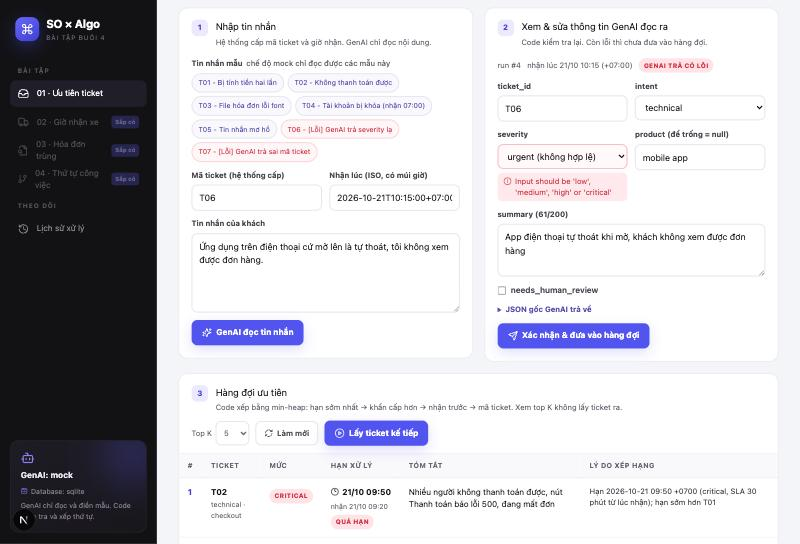
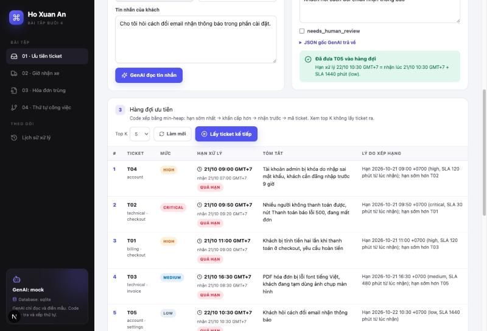
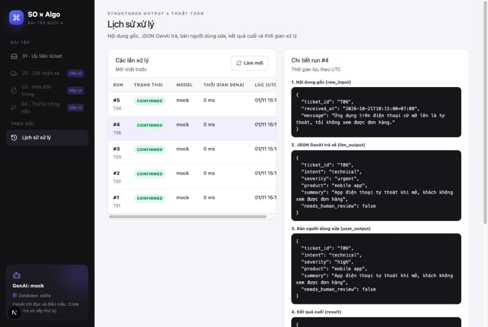
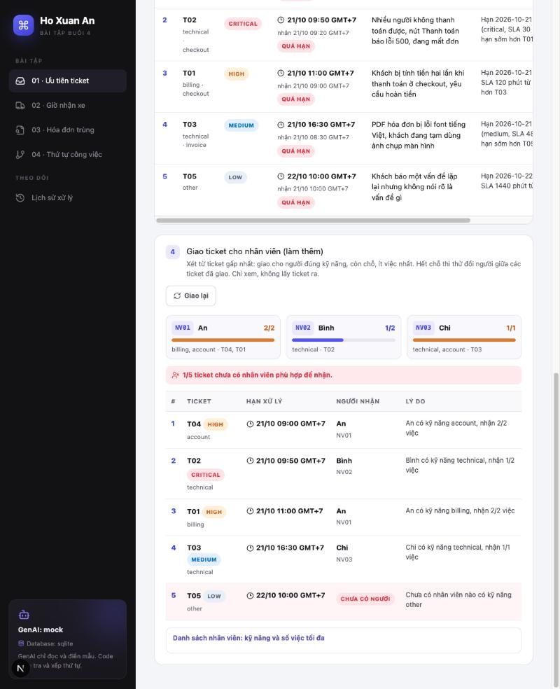
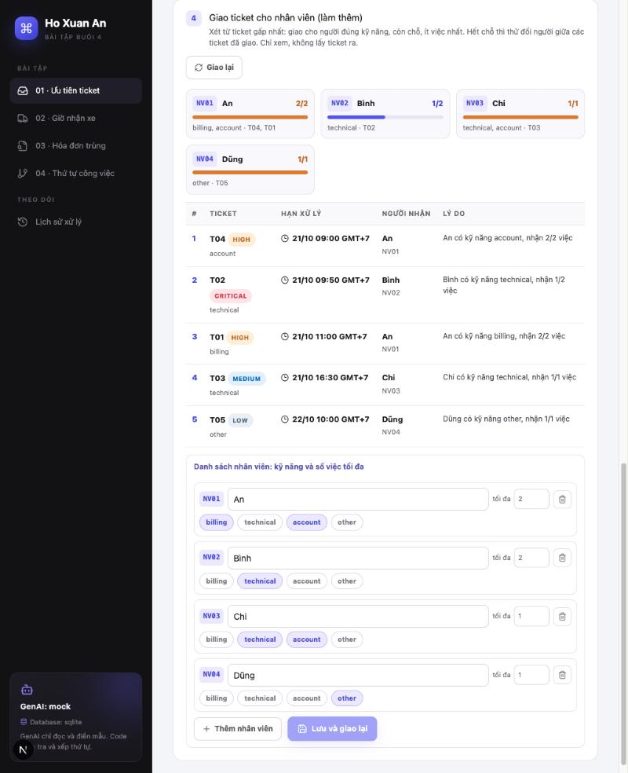

# Bài 01 · Khách hàng nào cần được hỗ trợ trước?

Nhóm chăm sóc khách hàng nhận nhiều tin nhắn cùng lúc. App đọc từng tin nhắn, rút ra thông tin chính, rồi xếp các yêu cầu (ticket) vào **hàng đợi ưu tiên**: ticket nào sắp trễ hạn thì xử lý trước, kèm lý do vì sao nó đứng ở vị trí đó.

← [README chung](../../README.md) (cách cài đặt và chạy)

## 1. GenAI làm gì, code làm gì

| Bước | Ai làm | Việc cụ thể |
|---|---|---|
| Cấp mã ticket | **Backend** | Tự sinh `T01`, `T02`... theo số tự tăng trong database. Trình duyệt không gửi mã, UI không sửa được mã |
| Giờ nhận | Hệ thống | `received_at` (bắt buộc có múi giờ) |
| Đọc tin nhắn | **GenAI** | Điền `intent`, `severity`, `product`, `summary`, `needs_human_review` vào mẫu JSON |
| Kiểm tra kết quả GenAI | **Code** | Đúng khuôn chưa (Pydantic), có trùng mã hệ thống đã cấp không, có cần người xem lại không |
| Xem và sửa | Nhân viên | Sửa ô GenAI đọc sai (trừ `ticket_id`), rồi bấm xác nhận |
| Tính hạn xử lý (SLA) | **Code** | `deadline = received_at + SLA[severity]`. GenAI **không** đoán hạn |
| Xếp hàng đợi, giải thích thứ tự | **Code** | Min-heap theo khóa `(deadline_at, -severity_rank, received_at, ticket_id)` |
| Giao ticket cho nhân viên (làm thêm) | **Code** | Theo kỹ năng và số việc tối đa, từ ticket gấp nhất. Chỉ ra ticket chưa có người phù hợp và vì sao |

GenAI chỉ làm một việc: chuyển văn bản tự do thành dữ liệu có cấu trúc. GenAI không tính hạn, không xếp thứ tự, và không tự quyết định ticket nào được vào hàng đợi. JSON đúng khuôn vẫn có thể chứa thông tin sai (ví dụ sai mã ticket), nên code luôn kiểm tra lại, và người dùng là người xác nhận cuối cùng.

```
tin nhắn ──► [GenAI] ──► JSON thô ──► [Code: kiểm tra 2 lớp] ──► người dùng xem/sửa
                                                                      │ xác nhận
                                                                      ▼
            hàng đợi ◄── [Code: min-heap] ◄── [Code: deadline = nhận lúc + SLA]
```

## 2. Mẫu dữ liệu GenAI phải trả

Mẫu được định nghĩa bằng Pydantic tại [`schemas.py`](../../backend/app/modules/tickets/schemas.py) (class `TicketExtraction`), rồi truyền vào `with_structured_output`. JSON Schema đầy đủ: [`ticket_extraction.schema.json`](ticket_extraction.schema.json).

```json
{
  "ticket_id": "T01",
  "intent": "billing",
  "severity": "high",
  "product": "checkout",
  "summary": "Khách bị tính tiền hai lần khi thanh toán ở checkout, yêu cầu hoàn tiền",
  "needs_human_review": false
}
```

| Ô | Kiểu | Quy tắc |
|---|---|---|
| `ticket_id` | string | Phải chép đúng mã backend đã cấp (có trong prompt), không tự đặt mã |
| `intent` | enum | `billing`, `technical`, `account`, `other` |
| `severity` | enum | `low`, `medium`, `high`, `critical` |
| `product` | string \| null | `null` nếu khách không nhắc sản phẩm nào. Vẫn là ô bắt buộc, GenAI phải ghi rõ `null` |
| `summary` | string | Không rỗng, tối đa 200 ký tự |
| `needs_human_review` | bool | `true` nếu tin nhắn mơ hồ (khi đó `intent` nên là `other`) |

Mẫu không cho phép ô lạ (`additionalProperties: false`). Ví dụ GenAI tự thêm ô `deadline` thì code báo lỗi.

### Kiểm tra 2 lớp ([`validation.py`](../../backend/app/modules/tickets/validation.py))

| Lớp | Bắt lỗi gì | Mức |
|---|---|---|
| 1. Khuôn (Pydantic) | Thiếu ô, thừa ô, sai kiểu, `severity` ngoài danh sách (vd `urgent`), summary dài hơn 200 ký tự hoặc rỗng | error |
| 2. Nghiệp vụ (code) | `ticket_id` khác mã hệ thống đã cấp | error |
| | GenAI đánh dấu `needs_human_review`; `intent=other` mà không đánh dấu xem lại; `product` là chuỗi rỗng | warning |

- **error**: chặn xác nhận, ticket chưa được vào hàng đợi.
- **warning**: chỉ nhắc để người dùng đọc lại, vẫn xác nhận được.

Tất cả lỗi được gom vào một danh sách, mỗi lỗi gắn với tên ô, để trang web hiển thị ngay dưới ô bị sai.

## 3. Thuật toán ([`algo.py`](../../backend/app/modules/tickets/algo.py))

**Hạn xử lý:** critical 30 phút, high 2 giờ, medium 8 giờ, low 24 giờ, tính từ `received_at`.

**Khóa so sánh** trong min-heap: `(deadline_at, -severity_rank, received_at, ticket_id)`, với critical=4, high=3, medium=2, low=1.
- Dấu trừ trước `severity_rank`: heap lấy giá trị nhỏ nhất ra trước, mà ta cần mức khẩn cấp cao được ưu tiên.
- `ticket_id` là duy nhất và nằm cuối khóa, nên hai ticket không bao giờ "hòa" hoàn toàn. Thứ tự luôn rõ ràng và lần nào chạy cũng giống nhau.

| Thao tác | Cách làm | Độ phức tạp |
|---|---|---|
| Thêm ticket | `heapq.heappush` | O(log n) |
| Lấy ticket kế tiếp | `heapq.heappop` | O(log n) |
| Xem top K | `heapq.nsmallest(k, heap)`: chỉ đọc, **không** sửa heap | O(n log k) |

**Lý do xếp hạng:** so ticket với ticket đứng ngay sau nó, đi lần lượt qua từng phần của khóa. Phần đầu tiên khác nhau chính là lý do, ví dụ "hạn sớm hơn T01", hoặc "cùng hạn với T05 nhưng khẩn cấp hơn".

**Mã trùng:** mã do backend cấp từ số tự tăng nên qua API bình thường không thể trùng. Gửi lại cùng một tin nhắn sẽ ra ticket mới với mã mới. Code vẫn giữ 2 lớp chặn phòng khi dữ liệu bị ghi sai: `TicketQueue` trong bộ nhớ, và khóa chính `ticket_id` trong database. Trùng thì từ chối với lỗi 409, không ghi đè, kể cả với mã đã được lấy ra xử lý.

**Ghi chú:** cùng mức khẩn cấp thì cùng SLA. Vì vậy hai ticket có cùng hạn và cùng mức thì chắc chắn được nhận cùng lúc. Luật thứ 3 "nhận trước" đã được phần deadline quyết định thay, nên trên thực tế không bao giờ là yếu tố phân định. Code vẫn giữ đủ khóa như đề, phòng khi sau này SLA thay đổi (ví dụ mỗi khách hàng có SLA riêng).

### Ví dụ trong đề

| ID | Nhận lúc | Severity | Hạn |
|---|---|---|---|
| T01 | 09:00 +07:00 | high | 11:00 |
| T02 | 09:20 +07:00 | critical | 09:50 |
| T03 | 08:30 +07:00 | medium | 16:30 |

Gửi lần lượt mẫu 1, 2, 3 thì backend cấp đúng mã T01, T02, T03 như đề. Kết quả: **T02 → T01 → T03**, top 2 là T02, T01. Thêm T04 (high, nhận 07:00, hạn 09:00) thì T04 lên đầu: **T04 → T02 → T01 → T03**.

### Làm thêm: giao ticket cho nhân viên

Đề: mỗi nhân viên có kỹ năng và số việc tối đa khác nhau; chỉ ra ticket nào chưa có nhân viên phù hợp để nhận.

- **Kỹ năng** là các loại yêu cầu (`intent`) người đó xử lý được: `billing`, `technical`, `account`, `other`.
- **Số việc tối đa** là số ticket nhận cùng lúc. `0` nghĩa là tạm không nhận, ví dụ đang nghỉ phép.
- Mặc định có 3 người, tạo sẵn khi bảng còn trống: An (billing, account, tối đa 2), Bình (technical, 2), Chi (technical, account, 1). Không ai làm `other`, nên ticket mơ hồ sẽ hiện là chưa có người nhận.

**Cách giao** (`assign_tickets`): xét lần lượt từ ticket gấp nhất, đúng thứ tự hàng đợi.
1. Có người đúng kỹ năng còn chỗ: giao cho người **đang ít việc nhất**. Bằng nhau thì chọn mã nhân viên đứng trước.
2. Không ai còn chỗ: thử **đổi người cho các ticket đã giao** để trống ra một chỗ (tìm đường tăng cường theo chiều rộng).
3. Đổi kiểu gì cũng không được: ticket này **chưa có nhân viên phù hợp**, kèm lý do.

Bước 2 cần có vì chỉ giao tham lam thì có thể báo sai. Ví dụ: Chi làm được cả technical lẫn account nhưng chỉ nhận 1 việc. T03 (account) vào Chi vì Chi đang rảnh hơn An, rồi T05 (technical) không còn ai nhận. Trong khi nếu An nhận T03 thì Chi nhận được T05. Bước 2 tìm ra cách đổi này.

- Ticket đã giao **không bao giờ bị bỏ ra**, chỉ có thể đổi người nhận. Vì vậy ticket gấp luôn được ưu tiên có người.
- Ticket bị báo "chưa có người nhận" là ticket **thật sự không xếp được** cùng với các ticket gấp hơn nó, chứ không phải do thứ tự chọn. Test đối chiếu điều này với cách thử mọi cách giao (brute force) trên 150 bộ dữ liệu ngẫu nhiên.
- Chỉ tính toán để xem: không lấy ticket nào ra khỏi hàng đợi, giống xem top K.

**Lý do:**

| Trường hợp | Ví dụ |
|---|---|
| Có người nhận | "An có kỹ năng billing, nhận 2/2 việc" |
| Không ai có kỹ năng | "Chưa có nhân viên nào có kỹ năng other" |
| Có người nhưng đều đã đủ việc | "Những người có kỹ năng account đều đã nhận đủ ticket gấp hơn (An 2/2, Chi 1/1). Đổi người giữa các ticket cũng không trống được chỗ" |

**Độ phức tạp:** với n ticket, m nhân viên, k loại yêu cầu (4), mỗi ticket tốn tối đa O(k·m²) để tìm cách đổi người, cả lần chạy là O(n·k·m²). Số nhân viên thường nhỏ, nên 5.000 ticket với 30 nhân viên chạy dưới 2 giây (test có kiểm tra).

**Ví dụ:** xác nhận mẫu 1–5 với 3 nhân viên mặc định. Hàng đợi là T04 → T02 → T01 → T03 → T05.

| Ticket | Loại | Người nhận | Vì sao |
|---|---|---|---|
| T04 | account | An | An và Chi cùng rảnh, An có mã đứng trước |
| T02 | technical | Bình | Bình và Chi cùng rảnh, Bình có mã đứng trước |
| T01 | billing | An | Chỉ An làm billing |
| T03 | technical | Chi | Bình đang có 1 việc, Chi chưa có việc nào |
| T05 | other | chưa có người | Không ai có kỹ năng other |

Thêm nhân viên Dũng làm `other` thì T05 có người nhận ngay.

## 4. API

| Endpoint | Việc làm | Lỗi |
|---|---|---|
| `POST /tickets/extract` | Nhận `received_at` và `message`. Backend cấp mã ticket, GenAI đọc tin nhắn, code kiểm tra, lưu lịch sử. Trả `ticket_id` và `run_id`. **Chưa** vào hàng đợi | 422 thời gian thiếu múi giờ |
| `POST /tickets/confirm` | Nhận `run_id` và bản đã sửa. Kiểm tra lại, tính deadline, đưa vào heap | 422 sai khuôn, 400 sai mã ticket, 404 không thấy run, 409 trùng mã hoặc run đã được xác nhận |
| `GET /tickets/queue?limit=K` | Top K kèm lý do xếp hạng, không lấy ticket ra | 422 nếu K nằm ngoài khoảng 1–100 |
| `POST /tickets/next` | Lấy ticket đầu hàng đợi, đánh dấu `done` | 404 nếu hàng đợi trống |
| `GET /tickets/samples` | Tin nhắn mẫu cho chế độ mock (không kèm mã ticket) | |
| `GET /tickets/staff` | Làm thêm: danh sách nhân viên (kỹ năng, số việc tối đa) | |
| `PUT /tickets/staff` | Làm thêm: thay cả danh sách. Người mới gửi `staff_id: null`, backend cấp mã `NV…` kế tiếp | 422 sai khuôn (kỹ năng lạ, số việc âm hoặc quá 50); 400 tên rỗng, mã trùng, mã không do hệ thống cấp, kỹ năng ghi lặp; lỗi thì không lưu gì |
| `GET /tickets/assignments` | Làm thêm: giao các ticket đang chờ cho nhân viên, kèm lý do. Chỉ xem, không lấy ticket ra | |
| `GET /runs?module=tickets`, `GET /runs/{id}` | Lịch sử xử lý | |
| `GET /health` | Đang dùng mock hay model nào, Supabase hay SQLite | |

**Mã ticket do backend cấp.** Ở bước extract, trình duyệt chỉ gửi giờ nhận và tin nhắn. Nếu gửi kèm `ticket_id` thì backend bỏ qua. Mã mới được ghi vào bảng `ticket_numbers` (bỏ qua mã đã có trong bảng `tickets`, ví dụ ticket nhập tay từ trước), đưa vào prompt để GenAI chép lại, và lưu trong `runs.raw_input`.

Ở bước confirm, mã ticket và giờ nhận được **lấy lại từ lần extract** (qua `run_id`), không lấy từ trình duyệt. Trên UI, ô `ticket_id` bị khóa và luôn gửi mã hệ thống. Nếu ai đó gọi thẳng API với mã khác thì nhận lỗi 400. Khi GenAI trả sai mã (mẫu 7), lỗi vẫn hiện ra, nhưng người dùng xác nhận được với mã hệ thống. Việc thay mã này **không** bị tính là "người dùng đã sửa".

Ví dụ gọi bằng `curl` (chế độ mock):

```bash
curl -s -X POST localhost:8000/tickets/extract -H 'content-type: application/json' \
  -d '{"received_at":"2026-10-21T09:20:00+07:00","message":"Từ 9 giờ tới giờ không ai trong công ty tôi thanh toán được, bấm nút Thanh toán là báo lỗi 500. Chúng tôi đang mất đơn liên tục!"}'
```

```bash
curl -s "localhost:8000/tickets/queue?limit=3"
```

## 5. Lưu lại để xem sau

Mỗi lần xử lý là một dòng trong bảng `runs` ([`core/entities.py`](../../backend/app/core/entities.py)):

| Đề yêu cầu lưu | Cột |
|---|---|
| Nội dung gốc | `raw_input` |
| JSON GenAI trả về | `llm_output` (giữ nguyên, kể cả khi sai khuôn) |
| Bản người dùng sửa | `user_output` |
| Kết quả cuối | `result`: deadline, SLA và `edited_fields` (các ô người dùng đã sửa) |
| Thời gian xử lý | `latency_ms`, `created_at`, `confirmed_at` |

Mã đã cấp được lưu ở bảng `ticket_numbers` (số tự tăng, mã, `run_id`). Ticket đã xác nhận được lưu ở bảng `tickets`. Heap nằm trong bộ nhớ để thao tác nhanh. Khi app khởi động, `load_queue()` đọc các ticket còn `queued` và dựng lại heap, nên hàng đợi không mất khi restart.

Làm thêm: danh sách nhân viên lưu ở bảng `ticket_staff` (mã, tên, kỹ năng, số việc tối đa). Kết quả giao việc **không lưu**: mỗi lần xem được tính lại từ hàng đợi hiện tại, nên luôn khớp với hàng đợi mới nhất.

## 6. Test

Chạy `cd backend && myenv/bin/python -m pytest -q`. Thuật toán được test riêng, không phụ thuộc GenAI.

| File | Số test | Nội dung |
|---|---|---|
| [`test_tickets_algo.py`](../../backend/tests/test_tickets_algo.py) | 188 | Thuật toán thuần: SLA, thứ tự, top K, phá hòa, dữ liệu sai. Làm thêm: giao ticket cho nhân viên, so với brute force trên 150 bộ dữ liệu ngẫu nhiên |
| [`test_tickets_validation.py`](../../backend/tests/test_tickets_validation.py) | 21 | Mẫu JSON và kiểm tra 2 lớp; danh sách nhân viên |
| [`test_tickets_extractor.py`](../../backend/tests/test_tickets_extractor.py) | 13 | GenAI (mock) và từng mẫu trong `samples/tickets.json` |
| [`test_tickets_store.py`](../../backend/tests/test_tickets_store.py) | 15 | Lưu lịch sử, múi giờ, dựng lại hàng đợi sau restart, sinh mã ticket, nhân viên mẫu |
| [`test_tickets_api.py`](../../backend/tests/test_tickets_api.py) | 42 | Toàn bộ API bằng `TestClient`, gồm cả việc backend cấp mã và giao ticket cho nhân viên |

Các test thuật toán, chia theo 3 nhóm đề yêu cầu:

- **Ca thường:** `test_sample_order_from_exercise` (T02 → T01 → T03), `test_top_k_does_not_remove_tickets`, `test_new_ticket_with_earlier_deadline_jumps_to_front` (T04), `test_deadline_is_computed_from_sla`.
- **Ca sát giới hạn:** `test_same_deadline_higher_severity_first`, `test_full_tie_falls_back_to_ticket_id`, `test_different_timezones_compare_by_real_instant` (02:00 UTC = 09:00 +07:00), `test_summary_exactly_200_chars_is_ok` / `..._201_chars_is_error`, `test_many_tickets_stay_sorted` (10.000 ticket).
- **Dữ liệu sai:** `test_duplicate_ticket_id_is_rejected`, `test_datetime_without_timezone_is_rejected`, `test_unknown_severity_is_rejected` (`urgent`, `HIGH`, `""`, `4`), `test_empty_ticket_id_is_rejected`.
- **Làm thêm, giao ticket cho nhân viên:** ca thường `test_least_busy_person_gets_the_ticket`, `test_reshuffle_frees_a_slot_instead_of_leaving_ticket_unassigned`; ca sát giới hạn `test_max_zero_means_not_taking_tickets`, `test_long_reshuffle_chain`, `test_many_tickets_run_fast`; dữ liệu sai `test_duplicate_staff_id_is_rejected`, `test_unknown_skill_is_rejected`; đối chiếu `test_matches_brute_force_on_random_data`.

### Đối chiếu phần "Tự kiểm tra" của đề

| Đề yêu cầu | Test |
|---|---|
| Thứ tự và top K đúng; xem top K không làm đổi lần lấy kế tiếp | `test_sample_order_and_top_k`, `test_viewing_top_k_does_not_change_next` |
| Cùng hạn và cùng mức thì phân định theo giờ nhận, rồi mã ticket | `test_full_tie_falls_back_to_ticket_id`, `test_same_severity_earlier_received_first` |
| Mã trùng, thời gian không có múi giờ, mức khẩn cấp sai: app báo rõ vấn đề | `test_duplicate_id_is_rejected_and_logged`, `test_same_message_twice_gets_two_tickets`, `test_received_at_without_timezone_is_422`, `test_bad_severity_from_genai_cannot_confirm` |
| GenAI trả sai ID: báo lỗi, chưa đưa vào hàng đợi | `test_wrong_ticket_id_is_400`, `test_wrong_ticket_id_confirmed_with_system_id` |
| Làm thêm: chỉ ra ticket chưa có nhân viên phù hợp | `test_no_one_with_skill_is_reported`, `test_less_urgent_ticket_is_the_one_left_out`, `test_assignments_follow_queue_and_show_who_cannot_be_served`, `test_full_staff_leaves_less_urgent_ticket_unassigned` |
| Làm thêm: xem bảng giao việc không lấy ticket ra | `test_viewing_assignments_does_not_remove_tickets` |
| Mã ticket do backend cấp, người dùng không sửa được | `test_extract_generates_ticket_id_and_saves_run`, `test_ticket_ids_are_sequential`, `test_ticket_id_from_browser_is_ignored`, `test_tampered_ticket_id_is_400`, `test_new_ticket_id_skips_existing_ticket` |

## 7. Dữ liệu mẫu (chế độ mock)

[`samples/tickets.json`](../../backend/samples/tickets.json) có 7 tin nhắn. Mỗi tin nhắn kèm JSON giả lập GenAI trả, nên chạy thử không tốn tiền gọi model. Mẫu không ghi sẵn mã ticket: ô `ticket_id` trong JSON giả lập là `"{ticket_id}"`, chế độ mock thay bằng mã backend vừa cấp.

| Mẫu | Mục đích |
|---|---|
| Mẫu 1, 2, 3 | Đúng ví dụ trong đề (gửi theo thứ tự này sẽ được T01, T02, T03) |
| Mẫu 4 | Nhận lúc 07:00, dùng để kiểm tra nó nhảy lên đầu hàng đợi |
| Mẫu 5 | Tin nhắn mơ hồ: cảnh báo `needs_human_review`, vẫn xác nhận được |
| Mẫu 6 | GenAI trả `severity: "urgent"`: bị chặn cho tới khi người dùng sửa |
| Mẫu 7 | GenAI tự đặt `ticket_id: "T70"` thay vì chép mã backend cấp: đúng khuôn nhưng sai nội dung |

## 8. Ảnh chụp luồng chính

**Bước 1–2: backend cấp mã T05, GenAI trả sai mã (mẫu 7).** Ô mã ticket ở cả hai bước đều bị khóa. Lỗi "GenAI trả 'T70' nhưng hệ thống đã cấp 'T05'" hiện ngay dưới ô, và ticket chưa vào hàng đợi.



**Bước 3: hàng đợi do code xếp.** Mẫu 1–4 được cấp T01–T04 như đề. T04 (hạn 09:00) đứng đầu, sau đó là T02 → T01 → T03, và T05 vừa xác nhận với mã hệ thống. Mỗi dòng có lý do xếp hạng. Thông báo xác nhận không ghi "đã sửa ticket_id", vì người dùng không sửa mã.



**Lịch sử xử lý:** `raw_input` có mã backend cấp (T05), `llm_output` giữ nguyên mã sai GenAI trả (T70), còn `user_output` dùng mã hệ thống (T05).



**Làm thêm, giao ticket cho nhân viên (mẫu 1–5):** An nhận T04 và T01 (đủ 2/2), Bình nhận T02, Chi nhận T03. T05 (`other`) được tô đỏ "chưa có người", kèm lý do không ai có kỹ năng này. Xem bảng không lấy ticket nào ra khỏi hàng đợi.



**Thêm nhân viên Dũng làm `other`:** backend cấp mã NV04 khi lưu, và T05 có người nhận ngay.



## 9. Giới hạn và các quyết định

- **Chỉ chạy 1 worker.** Heap nằm trong bộ nhớ của tiến trình, chạy nhiều worker thì mỗi worker có một hàng đợi riêng. Một `threading.Lock` bảo đảm hai request không sửa heap cùng lúc.
- **Thời gian trong database lưu theo UTC** (`timestamptz` trên Supabase). API trả về theo `APP_TIMEZONE`.
- **Mã ticket do backend cấp**, nên người dùng không tạo được mã trùng. Nếu vẫn trùng (dữ liệu ghi sai) thì từ chối, không cập nhật đè. Đề cho phép "từ chối hoặc nêu rõ quy tắc cập nhật".
- **Mã có thể bị "nhảy số".** Mỗi lần extract cấp một mã, kể cả khi người dùng không xác nhận. Ví dụ T05 không xác nhận thì hàng đợi có T04 rồi T06. Cách này giống số thứ tự tự tăng trong database, và giữ cho mã không bao giờ bị dùng lại.
- **Giao việc chỉ tính trên các ticket đang chờ.** Ticket đã lấy ra xử lý (`POST /tickets/next`) không tính vào số việc của ai, vì app chưa ghi ai đang làm ticket đó. Muốn tính thì cần thêm bước "nhận ticket" có ghi tên người nhận.
- **Kỹ năng chỉ theo loại yêu cầu.** Chưa xét sản phẩm (`product`) hay mức khẩn cấp, ví dụ chỉ người lâu năm mới nhận `critical`.
- **Chế độ mock chỉ đọc được tin nhắn có trong `samples/`.** Tin nhắn khác sẽ báo lỗi rõ ràng, không bịa ra kết quả.
- **`method="function_calling"`** được dùng thay cho mặc định `json_schema` của LangChain, vì chế độ strict của OpenAI không nhận một số ràng buộc như `max_length`. Ràng buộc vẫn được Pydantic kiểm tra lại ở bước sau.
