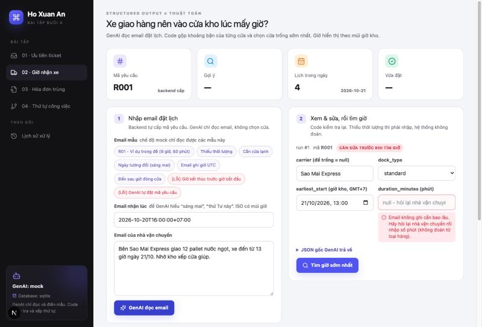
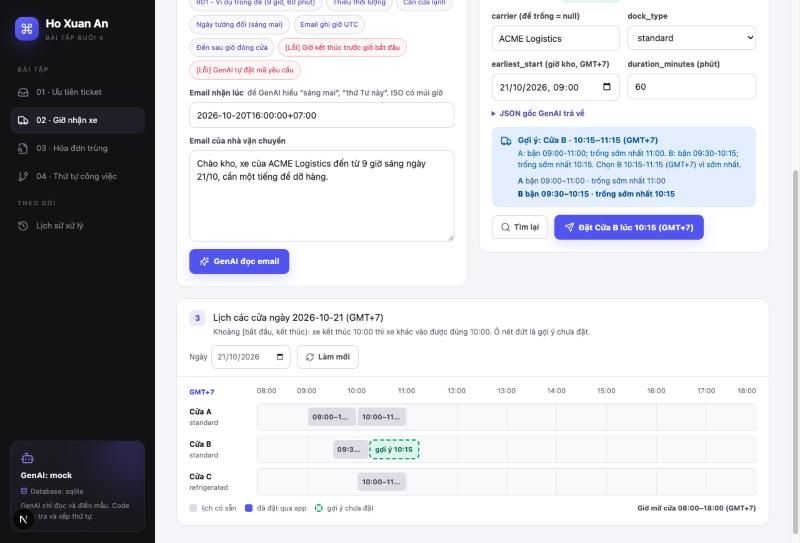
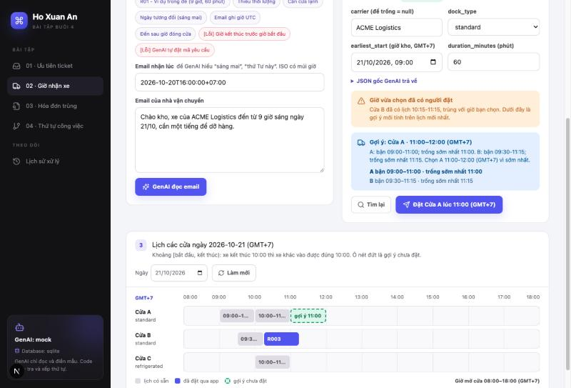
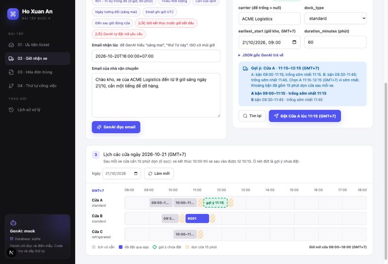

# Bài 02 · Xe giao hàng nên vào cửa kho lúc mấy giờ?

Kho có nhiều cửa nhận hàng, mỗi cửa chỉ phục vụ một xe tại một thời điểm. Nhà vận chuyển gửi email kiểu "xe tôi đến từ 9 giờ, cần một tiếng để dỡ hàng". App đọc email, tìm **cửa trống sớm nhất** và giải thích vì sao chọn cửa đó, đồng thời **chặn hai người đặt cùng một giờ** trên cùng một cửa.

← [README chung](../../README.md) (cách cài đặt và chạy)

## 1. GenAI làm gì, code làm gì

| Bước | Ai làm | Việc cụ thể |
|---|---|---|
| Cấp mã yêu cầu | Hệ thống | `request_id` dạng R001, R002…, sinh từ số tự tăng của database |
| Đọc email | **GenAI** | Điền `carrier`, `earliest_start`, `duration_minutes`, `dock_type`, `missing_fields` |
| Kiểm tra kết quả GenAI | **Code** | Đúng khuôn chưa (Pydantic), đúng mã đã cấp chưa, có thiếu thời lượng hay giờ đến không, giờ đến có nằm trong giờ mở cửa không |
| Xem và sửa | Nhân viên | Nhập phần còn thiếu (ví dụ thời lượng sau khi hỏi lại nhà vận chuyển) |
| Tìm giờ | **Code** | Gộp khoảng bận của từng cửa, tìm khoảng trống đầu tiên đủ dài. GenAI **không** chọn cửa |
| Đặt lịch | **Code** | Kiểm tra lại trên lịch mới nhất rồi mới lưu. Trùng giờ thì trả 409 kèm gợi ý mới |

```
email ──► [GenAI] ──► JSON thô ──► [Code: kiểm tra 2 lớp, đổi về giờ kho] ──► người dùng xem/sửa
                                                                                   │ tìm giờ
                                                                                   ▼
          lịch đã lưu ◄── [Code: khóa + kiểm tra lại] ◄── xác nhận ◄── [Code: gộp interval, chọn cửa]
```

## 2. Mẫu dữ liệu GenAI phải trả

Mẫu định nghĩa bằng Pydantic tại [`schemas.py`](../../backend/app/modules/docks/schemas.py) (class `DockRequestExtraction`). JSON Schema đầy đủ: [`dock_request_extraction.schema.json`](dock_request_extraction.schema.json).

```json
{
  "request_id": "R001",
  "carrier": "ACME Logistics",
  "earliest_start": "2026-10-21T09:00:00",
  "duration_minutes": 60,
  "dock_type": "standard",
  "missing_fields": []
}
```

| Ô | Kiểu | Quy tắc |
|---|---|---|
| `request_id` | string | Chép đúng mã hệ thống đã cấp trong prompt. Email có ghi mã khác cũng không được dùng |
| `carrier` | string \| null | `null` nếu email không ghi |
| `earliest_start` | datetime \| null | Giờ sớm nhất xe có thể đến. Giữ nguyên giờ ghi trong email, không tự đổi sang UTC. Ngày tương đối ("sáng mai") tính theo giờ nhận email |
| `duration_minutes` | int \| null, > 0 | `null` nếu email không nói. **Không** đoán từ loại hàng hay số pallet |
| `dock_type` | enum | `standard` hoặc `refrigerated` (hàng lạnh, đông lạnh) |
| `missing_fields` | list | Đúng những ô đang để `null`, chỉ gồm `carrier`, `earliest_start`, `duration_minutes`. Ô đã có giá trị thì không ghi; đủ thông tin thì `[]` |

### Múi giờ

Đề yêu cầu `earliest_start` phải có múi giờ. App xử lý như sau:

- Email thường ghi "9 giờ" mà không ghi múi giờ. Vì vậy prompt dặn GenAI trả giờ **không kèm múi giờ**, và code gắn múi giờ của kho (`APP_TIMEZONE`, mặc định `Asia/Ho_Chi_Minh` = GMT+7). Làm vậy thì GenAI không phải tự đoán múi giờ.
- Email ghi rõ múi giờ khác (ví dụ "02:00 UTC") thì GenAI ghi kèm múi giờ, và code đổi về giờ kho: 02:00Z thành 09:00 GMT+7, vẫn là cùng một thời điểm.
- Sau bước kiểm tra, mọi giờ đều **có múi giờ**. Thuật toán từ chối giờ không có múi giờ.
- Database lưu theo UTC. API và giao diện luôn hiển thị kèm nhãn múi giờ (ví dụ "10:15 (GMT+7)").

### Kiểm tra 2 lớp ([`validation.py`](../../backend/app/modules/docks/validation.py))

| Lớp | Bắt lỗi gì | Mức |
|---|---|---|
| 1. Khuôn (Pydantic) | Thiếu ô, thừa ô, sai kiểu, `duration_minutes` ≤ 0, `dock_type` hoặc `missing_fields` ngoài danh sách, giờ sai định dạng | error |
| 2. Nghiệp vụ (code) | `request_id` khác mã đã cấp; thiếu `duration_minutes` (hỏi lại người dùng); thiếu `earliest_start` | error |
| | Thiếu `carrier`; `missing_fields` không khớp với các ô đang `null`; đến trước giờ mở cửa hoặc sau giờ đóng cửa; thời lượng dài hơn cả ngày làm việc | warning |

- **error**: chặn tìm giờ và đặt lịch.
- **warning**: chỉ nhắc. Ví dụ đến 07:30 thì thuật toán vẫn xếp từ 08:00.

Giờ kết thúc trước giờ bắt đầu không thể xảy ra ở mẫu này, vì giờ kết thúc luôn do code tính bằng `start + duration`. Nếu GenAI hiểu sai thành thời lượng âm (`-60`) thì lớp 1 chặn lại. Ở tầng thuật toán và database cũng có lớp chặn riêng: `Interval` từ chối `end <= start`, và bảng có `CHECK (end_at > start_at)`.

## 3. Thuật toán ([`algo.py`](../../backend/app/modules/docks/algo.py))

Với mỗi cửa đúng loại:

1. **Gộp khoảng bận** (`merge_intervals`): sắp xếp lịch theo giờ bắt đầu, rồi đi một lượt. Lịch nào bắt đầu **trước hoặc đúng lúc** khoảng hiện tại kết thúc thì nối vào khoảng đó. Ví dụ 09:00–10:00 và 10:00–11:00 gộp thành 09:00–11:00.
2. **Tìm khoảng trống đầu tiên** (`first_gap`): con trỏ bắt đầu từ `max(giờ xe đến, giờ mở cửa)`. Đi qua từng khoảng bận: nếu từ con trỏ tới đầu khoảng bận đủ thời lượng thì chọn chỗ đó, nếu không thì dời con trỏ tới cuối khoảng bận. Cuối cùng kiểm tra khoảng còn lại trước giờ đóng cửa.
3. **Chọn cửa**: giờ bắt đầu sớm nhất. Nếu bằng nhau thì chọn mã cửa đứng trước theo alphabet (`min` theo khóa `(free_from, dock_id)`).
4. Không cửa nào còn chỗ thì trả `no_slot` kèm lý do. **Không** tự chuyển sang hôm sau.

| Thao tác | Độ phức tạp |
|---|---|
| Sắp xếp và gộp n lịch | O(n log n) |
| Tìm khoảng trống trên các khoảng đã gộp | O(n) |

**Khoảng `[start, end)`:** xe rời cửa lúc 10:00 thì xe sau vào được đúng 10:00. Cả thuật toán, câu truy vấn kiểm tra trùng (`start_at < end_mới AND end_at > start_mới`) và ràng buộc database (`tstzrange(..., '[)')`) đều dùng cùng một quy ước này.

**Lý do:** mỗi gợi ý kèm tình trạng từng cửa, ví dụ:

> A: bận 09:00-11:00; trống sớm nhất 11:00. B: bận 09:30-10:15; trống sớm nhất 10:15. Chọn B 10:15-11:15 (GMT+7) vì sớm nhất.

### Làm thêm: 15 phút dọn cửa

Bật bằng biến `DOCK_CLEANUP_MINUTES=15` trong `.env`. Mặc định là `0`, để ví dụ trong đề vẫn ra B 10:15.

- **Khoảng bận của lịch cũ kéo dài thêm 15 phút** (`merge_intervals(..., cleanup)`). Với lịch trong đề: A bận tới 11:15, B bận tới 10:30, nên kết quả là **B 10:30–11:30**.
- **Khoảng trống trước một lịch phải đủ `thời lượng + 15 phút`** (`first_gap(..., cleanup)`), vì xe mới xong cũng phải dọn rồi xe sau mới vào được. Ví dụ A trống 11:15–12:20 (65 phút) thì chưa đủ cho xe 60 phút.
- **Xe cuối ngày chỉ cần rời cửa trước giờ đóng cửa.** Việc dọn được làm sau 18:00.
- **Lúc xác nhận** (`create_booking`), câu kiểm tra trùng cũng kéo dài cả lịch cũ lẫn lịch mới thêm 15 phút: `start_at < end_mới + 15' AND end_at > start_mới - 15'`. Test `test_cleanup_suggestion_never_conflicts_with_confirm_rule` chạy 300 lịch ngẫu nhiên để chắc rằng giờ đã gợi ý thì lúc xác nhận không bị báo trùng.
- API trả thêm `cleanup_minutes` trong kết quả gợi ý, lịch đã đặt và lịch ngày. Timeline vẽ đoạn dọn cửa thành ô sọc sau mỗi xe.

Cửa lạnh (phần làm thêm còn lại) đã có từ đầu: yêu cầu `refrigerated` chỉ xét cửa C.

## 4. Chặn hai người đặt cùng một giờ

Gợi ý chỉ đúng tại lúc tính. Lúc bấm xác nhận, có thể người khác vừa đặt mất giờ đó. Vì vậy `POST /docks/bookings/confirm` **không tin vào gợi ý cũ**, mà kiểm tra theo 3 lớp:

| Lớp | Ở đâu | Làm gì |
|---|---|---|
| Khóa trong app | [`router.py`](../../backend/app/modules/docks/router.py) | `threading.Lock`: trong một tiến trình, mỗi lúc chỉ một request được đặt lịch. Cần thiết với SQLite, vì SQLite bỏ qua `FOR UPDATE` |
| Khóa dòng | [`store.py`](../../backend/app/modules/docks/store.py) `create_booking` | `SELECT … FOR UPDATE` trên dòng của cửa, kiểm tra lại trùng giờ trên dữ liệu mới nhất, rồi lưu lịch đặt, trạng thái yêu cầu và lịch sử trong **cùng một transaction** |
| Ràng buộc database | [`entities.py`](../../backend/app/modules/docks/entities.py), [`schema.sql`](../../backend/supabase/schema.sql) | Trên Supabase: `EXCLUDE USING gist (dock_id WITH =, tstzrange(start_at, end_at, '[)') WITH &&)`. Database tự từ chối hai lịch chồng nhau, kể cả khi chạy nhiều worker. Ràng buộc này không biết thời gian dọn cửa: phần dọn cửa do lớp khóa dòng kiểm tra |

Bị trùng thì API trả **409** kèm gợi ý mới tính trên lịch mới nhất:

```json
{
  "detail": {
    "message": "Cửa B đã có lịch 10:15-11:15, trùng với giờ bạn chọn",
    "suggestion": { "status": "ok", "dock_id": "A", "start": "2026-10-21T11:00:00+07:00", "...": "..." }
  }
}
```

Lần extract **không** bị đánh dấu là `rejected`, nên người dùng bấm đặt lại theo gợi ý mới là được. Mỗi mã yêu cầu chỉ đặt được một lần (`request_id` là unique).

## 5. API

Đề yêu cầu tối thiểu 3 API: `POST /requests/extract`, `/slots/suggest`, `/bookings/confirm`. App giữ đúng các đường dẫn này và thêm tiền tố `/docks`, để 4 bài trong cùng một app không bị trùng tên.

| Endpoint | Việc làm | Lỗi |
|---|---|---|
| `POST /docks/requests/extract` | Sinh mã yêu cầu, GenAI đọc email, code kiểm tra, lưu lịch sử. **Chưa** tìm giờ | 422 `received_at` thiếu múi giờ |
| `POST /docks/slots/suggest` | Kiểm tra lại bản đã sửa, chạy thuật toán trên lịch mới nhất. **Chưa** đặt | 400 còn lỗi (thiếu thời lượng, sai mã), 404 không thấy run, 409 đã đặt rồi |
| `POST /docks/bookings/confirm` | Nhận `run_id`, bản đã sửa, `dock_id`, `start`. Kiểm tra lại rồi lưu | 400 ngoài giờ mở cửa, sớm hơn giờ xe đến hoặc sai loại cửa; 409 trùng giờ (kèm gợi ý mới) hoặc đã đặt; 422 `start` thiếu múi giờ |
| `GET /docks/schedule?date=YYYY-MM-DD` | Lịch một ngày của các cửa, kèm giờ mở, đóng cửa, nhãn múi giờ và số phút dọn cửa | |
| `GET /docks/samples` | Email mẫu cho chế độ mock | |
| `GET /runs?module=docks` | Lịch sử xử lý | |

Mã yêu cầu được **lấy lại từ lần extract** (qua `run_id`), không tin vào trình duyệt.

Ví dụ gọi bằng `curl` (chế độ mock):

```bash
curl -s -X POST localhost:8000/docks/requests/extract -H 'content-type: application/json' \
  -d '{"received_at":"2026-10-20T16:00:00+07:00","email":"Chào kho, xe của ACME Logistics đến từ 9 giờ sáng ngày 21/10, cần một tiếng để dỡ hàng."}'
```

```bash
curl -s "localhost:8000/docks/schedule?date=2026-10-21"
```

## 6. Dữ liệu và lưu lại để xem sau

| Bảng | Nội dung |
|---|---|
| `docks` | Cửa A, B (`standard`) và C (`refrigerated`) |
| `dock_requests` | Mã yêu cầu, run tương ứng, trạng thái `new` hoặc `booked` |
| `dock_bookings` | Lịch đã đặt: cửa, `start_at`, `end_at` (UTC), nhà vận chuyển, mã yêu cầu |
| `runs` | Email gốc (`raw_input`), JSON GenAI trả (`llm_output`), bản người dùng sửa (`user_output`), kết quả cuối (`result`: cửa, giờ, `edited_fields`), thời gian xử lý |

Lúc khởi động, app nạp cửa và lịch có sẵn của ngày 21/10/2026 (đúng ví dụ trong đề) nếu bảng còn trống: A 09:00–10:00, A 10:00–11:00, B 09:30–10:15, và thêm C 10:00–11:00 để thử cửa lạnh.

`edited_fields` được so với bản GenAI **đã đổi về giờ kho**, nên "02:00Z" và "09:00+07:00" không bị tính là người dùng đã sửa.

## 7. Test

Chạy `cd backend && myenv/bin/python -m pytest -q`. Thuật toán được test riêng, không phụ thuộc GenAI.

| File | Số test | Nội dung |
|---|---|---|
| [`test_docks_algo.py`](../../backend/tests/test_docks_algo.py) | 63 | Thuật toán thuần, so với brute force trên 30 lịch ngẫu nhiên, 10.000 lịch dưới 1 giây, thời gian dọn cửa |
| [`test_docks_validation.py`](../../backend/tests/test_docks_validation.py) | 28 | Mẫu JSON, kiểm tra 2 lớp, múi giờ |
| [`test_docks_extractor.py`](../../backend/tests/test_docks_extractor.py) | 26 | GenAI (mock), prompt, từng mẫu trong `samples/docks.json` |
| [`test_docks_store.py`](../../backend/tests/test_docks_store.py) | 18 | Database: seed, mã tuần tự, khóa, trùng giờ, DDL có `EXCLUDE` |
| [`test_docks_api.py`](../../backend/tests/test_docks_api.py) | 27 | Toàn bộ API bằng `TestClient`, có test 2 thread xác nhận cùng lúc và test bật 15 phút dọn cửa |

### Đối chiếu phần "Tự kiểm tra" của đề

| Đề yêu cầu | Test |
|---|---|
| Ví dụ trả về cửa B lúc 10:15; hai lịch nối sát nhau là một khoảng bận | `test_sample_from_exercise_gives_dock_b_at_10_15`, `test_touching_bookings_merge_into_one_busy_block`, `test_suggest_exercise_example_gives_b_at_10_15` |
| Hỏi lại sau khi R01 đã đặt thì kết quả đổi | `test_result_changes_after_r01_is_booked`, `test_confirm_books_and_changes_schedule` |
| Lịch cũ kết thúc đúng lúc lịch mới bắt đầu không bị báo trùng | `test_booking_ending_when_new_one_starts_is_not_a_conflict`, `test_touching_booking_is_allowed` |
| Thiếu thời lượng | `test_missing_duration_blocks_search`, `test_missing_duration_blocks_suggest_until_user_fills_it` |
| Sai múi giờ | `test_other_timezone_is_converted_to_warehouse_time`, `test_utc_email_is_converted_to_warehouse_time`, `test_naive_datetime_is_rejected`, `test_extract_request_rejects_received_at_without_timezone` |
| Giờ kết thúc trước giờ bắt đầu | `test_end_before_start_is_rejected`, `test_duration_zero_or_negative_is_error`, `test_negative_duration_is_blocked` |
| Hết chỗ | `test_fully_booked_day_is_no_slot`, `test_arriving_after_closing_is_no_slot`, `test_after_closing_has_no_slot` |
| Hai người cùng đặt một giờ | `test_second_person_gets_409_with_new_suggestion`, `test_two_people_confirming_at_the_same_time`, `test_postgres_ddl_has_exclusion_constraint` |
| Làm thêm: cửa lạnh | `test_refrigerated_request_only_uses_cold_dock`, `test_refrigerated_goes_to_dock_c` |
| Làm thêm: 15 phút dọn cửa, khoảng bận tính cả thời gian dọn | `test_cleanup_buffer_extends_busy_blocks`, `test_gap_must_fit_cleanup_before_next_booking`, `test_cleanup_suggestion_never_conflicts_with_confirm_rule`, `test_cleanup_buffer_makes_touching_booking_conflict`, `test_cleanup_moves_example_to_b_at_10_30`, `test_cleanup_confirm_right_after_previous_truck_is_409`, `test_cleanup_next_truck_waits_for_cleanup` |

## 8. Dữ liệu mẫu (chế độ mock)

[`samples/docks.json`](../../backend/samples/docks.json) có 8 email, đều nhận lúc 16:00 ngày 20/10/2026 (GMT+7). Mẫu dùng `"{request_id}"` để mock tự điền mã do backend vừa sinh.

| Mẫu | Mục đích |
|---|---|
| R01 - Ví dụ trong đề | 9 giờ, 60 phút, kết quả B 10:15–11:15 |
| Thiếu thời lượng | `duration_minutes = null`: phải hỏi lại, không đoán từ "12 pallet" |
| Cần cửa lạnh | `refrigerated`: chỉ xét cửa C, kết quả C 11:00 |
| Ngày tương đối | "Sáng mai 8 giờ", được hiểu là 21/10 08:00 |
| Email ghi giờ UTC | 02:00Z = 09:00 GMT+7 |
| Đến sau giờ đóng cửa | 18:30: cảnh báo, tìm giờ ra `no_slot` |
| [Lỗi] Giờ kết thúc trước giờ bắt đầu | GenAI trả `duration_minutes = -60`: bị chặn |
| [Lỗi] GenAI tự đặt mã | GenAI chép "R01" trong email thay vì mã hệ thống cấp: đúng khuôn nhưng sai nội dung |

### Chạy thử với model thật (gpt-4o-mini)

Gửi mỗi mẫu 3 lần qua API với OpenAI (database là SQLite tạm).

| Kiểm tra | Trước khi sửa prompt | Sau khi sửa |
|---|---|---|
| R01 (ví dụ của đề) ra cửa B 10:15–11:15, xe sau ra A 11:00 | Đúng | Đúng |
| Mẫu 1–6 cho kết quả "gợi ý được giờ hay chưa" đúng như mong đợi | 17/18 | 18/18 |
| JSON sai khuôn, bị chặn ngay ở lớp 1 | 1/24 lần | 0/24 |
| `missing_fields` không khớp với các ô đang `null` | 10/24 lần | 7/24 lần |

Prompt được sửa ở 2 điểm:
- `missing_fields` chỉ ghi những ô đang để `null`; email đủ thông tin thì để `[]`.
- Giữ nguyên giờ ghi trong email, không tự đổi sang UTC. Ở lượt chạy đầu, model từng đổi "13 giờ" thành `06:00` mà bỏ mất múi giờ.

`missing_fields` sai chỉ làm hiện cảnh báo: code tự so với các ô đang `null`, nên không ảnh hưởng tới giờ được gợi ý.

## 9. Ảnh chụp luồng chính

**Thiếu thời lượng:** GenAI để `duration_minutes = null` thay vì đoán từ "12 pallet". Ô bị tô đỏ kèm lời nhắc hỏi lại nhà vận chuyển, và chưa tìm giờ được.



**Gợi ý và lịch:** email trong đề cho kết quả B 10:15–11:15 (GMT+7), kèm tình trạng từng cửa. Trên timeline, ô nét đứt là gợi ý chưa đặt.



**Hai người cùng đặt:** R003 vừa đặt B 10:15 (ô tím). R002 bấm xác nhận sau thì nhận lỗi 409 và gợi ý mới A 11:00.



**Làm thêm, 15 phút dọn cửa (`DOCK_CLEANUP_MINUTES=15`):** R001 đã đặt B 10:30–11:30, nên B bận tới 11:45. A bận tới 11:15, vì vậy xe tiếp theo được gợi ý A 11:15–12:15. Ô sọc là thời gian dọn cửa sau mỗi xe.



## 10. Giới hạn và các quyết định

- **Giờ mở cửa 08:00–18:00** cấu hình bằng `DOCK_OPEN`, `DOCK_CLOSE`, áp dụng cho mọi ngày. Chưa có lịch nghỉ hay ngày lễ.
- **Một yêu cầu chỉ đặt một lần.** Muốn đổi giờ thì tạo yêu cầu mới. Chưa có chức năng hủy lịch.
- **Người dùng chỉ đặt theo gợi ý trên giao diện.** API vẫn cho chọn cửa và giờ khác, miễn là còn trống, đúng loại cửa và nằm trong giờ mở cửa.
- **Khóa trong app chỉ có tác dụng trong 1 tiến trình.** Chạy nhiều worker trên Supabase thì khóa dòng và ràng buộc `EXCLUDE` vẫn bảo vệ. Trên SQLite thì chỉ nên chạy 1 worker.
- **Chế độ mock chỉ đọc được email có trong `samples/`.**
- **Thời gian dọn cửa giống nhau cho mọi cửa và mọi xe** (`DOCK_CLEANUP_MINUTES`). Chưa có thời gian dọn riêng cho từng loại cửa, ví dụ cửa lạnh cần dọn lâu hơn.
- **Đổi `DOCK_CLEANUP_MINUTES` không làm thay đổi lịch đã đặt.** Số phút mới chỉ áp dụng cho các lần gợi ý và xác nhận sau đó.
