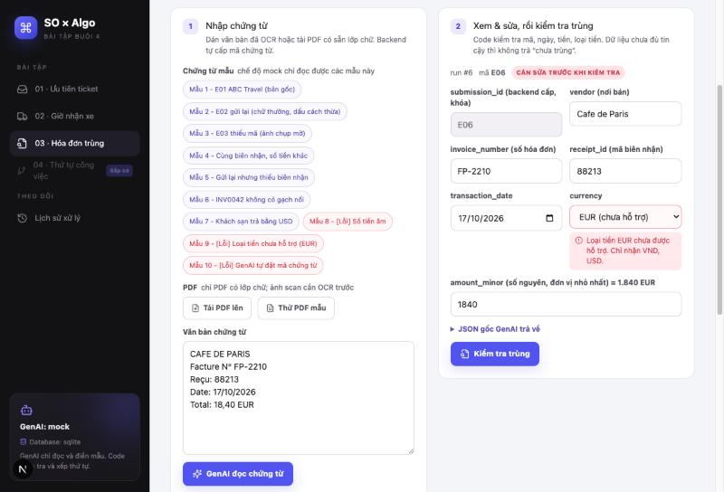
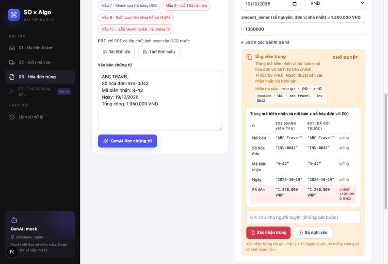
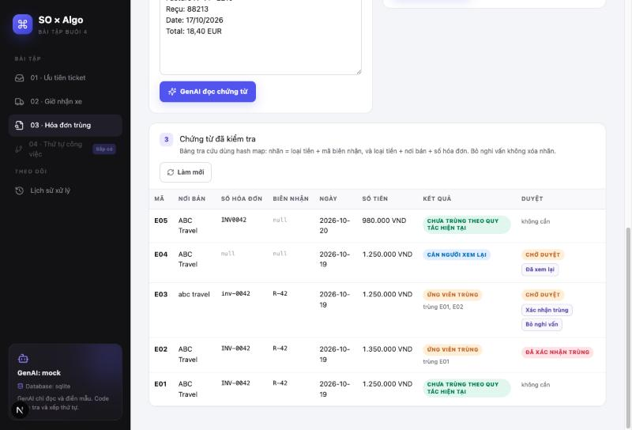

# Bài 03 · Hóa đơn này đã được gửi trước đó chưa?

Nhân viên đi công tác gửi hóa đơn để công ty hoàn tiền. Vài ngày sau, cùng hóa đơn có thể được gửi lại qua email hoặc một bản chụp khác. App đọc thông tin trên chứng từ, rồi **đánh dấu những bản có thể đã được gửi trước đó** để người duyệt kiểm tra.

App chỉ giúp người duyệt. App **không** tự kết luận nhân viên gian lận và **không** tự từ chối hoàn tiền.

← [README chung](../../README.md) (cách cài đặt và chạy)

## 1. GenAI làm gì, code làm gì

| Bước | Ai làm | Việc cụ thể |
|---|---|---|
| Lấy chữ từ chứng từ | Người dùng / code | Dán văn bản đã OCR, hoặc tải PDF có sẵn lớp chữ để code lấy chữ (`pypdf`) |
| Cấp mã chứng từ | Hệ thống | `submission_id` dạng E01, E02…, sinh từ số tự tăng của database |
| Đọc chứng từ | **GenAI** | Điền `vendor`, `invoice_number`, `transaction_date`, `amount_minor`, `currency`, `receipt_id`, `missing_fields` |
| Kiểm tra kết quả GenAI | **Code** | Đúng khuôn chưa (Pydantic), đúng mã đã cấp chưa, loại tiền có được hỗ trợ không, tiền có âm không, ngày có ở tương lai không |
| Xem và sửa | Nhân viên | Sửa ô GenAI đọc sai. Ô mã chứng từ bị khóa |
| Tìm bản có thể trùng | **Code** | Chuẩn hóa, tạo nhãn tra cứu, tìm trong hash map. GenAI **không** quyết định trùng hay không |
| Duyệt | Người duyệt | Xác nhận trùng, bỏ nghi vấn, hoặc sửa thông tin rồi kiểm tra lại |

```
văn bản / PDF ──► [GenAI] ──► JSON thô ──► [Code: kiểm tra 2 lớp] ──► người dùng xem/sửa
                                                                          │ kiểm tra trùng
                                                                          ▼
   người duyệt: xác nhận / bỏ nghi vấn ◄── kết quả + cặp nghi trùng ◄── [Code: nhãn + hash map]
              └── sửa thông tin ──► [Code: kiểm tra lại trên bảng tra cứu mới nhất]
```

## 2. Mẫu dữ liệu GenAI phải trả

Mẫu định nghĩa bằng Pydantic tại [`schemas.py`](../../backend/app/modules/expenses/schemas.py) (class `ExpenseExtraction`). JSON Schema đầy đủ: [`expense_extraction.schema.json`](expense_extraction.schema.json).

```json
{
  "submission_id": "E01",
  "vendor": "ABC Travel",
  "invoice_number": "INV-0042",
  "transaction_date": "2026-10-19",
  "amount_minor": 1250000,
  "currency": "VND",
  "receipt_id": "R-42",
  "missing_fields": []
}
```

| Ô | Kiểu | Quy tắc |
|---|---|---|
| `submission_id` | string | Chép đúng mã hệ thống đã cấp trong prompt. Không dùng số hóa đơn làm mã |
| `vendor` | string \| null | Tên nơi bán, giữ nguyên cách viết trên chứng từ |
| `invoice_number` | string \| null | Số hóa đơn, chép đúng từng ký tự, **kể cả dấu gạch nối**. Tối đa 64 ký tự |
| `transaction_date` | date \| null | `YYYY-MM-DD`. Chứng từ tiếng Việt ghi ngày trước tháng (19/10/2026 là ngày 19 tháng 10) |
| `amount_minor` | int \| null, ≥ 0 | Tổng tiền ở **đơn vị nhỏ nhất**, là số nguyên thật (xem bên dưới) |
| `currency` | string \| null | Mã ISO 4217 gồm 3 chữ in hoa. Chứng từ ghi EUR thì giữ EUR, không tự đổi |
| `receipt_id` | string \| null | Mã biên nhận, chép đúng từng ký tự |
| `missing_fields` | list | Tên các ô để `null` vì không đọc được |

Mẫu không cho phép ô lạ (`additionalProperties: false`). Vì vậy GenAI không thể tự thêm `"status": "duplicate"`, tức là không thể tự kết luận chứng từ có trùng hay không.

### Tiền ở đơn vị nhỏ nhất

| Trên chứng từ | `amount_minor` | `currency` |
|---|---|---|
| 1.250.000 VND | `1250000` (đồng) | `VND` |
| USD 125.50 | `12550` (cent) | `USD` |

- Tiền lưu bằng **số nguyên** nên khi so sánh không bị sai số như số thực (`0.1 + 0.2 ≠ 0.3`).
- Ô này dùng `strict=True`: các giá trị `12.5`, `"1250000"`, `"1.250.000"`, `true` đều bị lớp 1 từ chối. GenAI phải tự đổi ra số nguyên, code không đoán thay.
- App hỗ trợ **VND** (0 chữ số lẻ) và **USD** (2 chữ số lẻ), khai báo ở một chỗ duy nhất: `MINOR_DIGITS` trong [`algo.py`](../../backend/app/modules/expenses/algo.py).

### Kiểm tra 2 lớp ([`validation.py`](../../backend/app/modules/expenses/validation.py))

| Lớp | Bắt lỗi gì | Mức |
|---|---|---|
| 1. Khuôn (Pydantic) | Thiếu ô, thừa ô, sai kiểu, **tiền âm**, tiền không phải số nguyên, ngày sai định dạng, mã dài quá 64 ký tự, `missing_fields` ngoài danh sách | error |
| 2. Nghiệp vụ (code) | `submission_id` khác mã đã cấp; **loại tiền chưa hỗ trợ** (`EUR`) hoặc không phải mã 3 chữ in hoa (`vnd`, `đ`); **ngày giao dịch sau hôm nay**; chuỗi rỗng `"   "` (không đọc được thì phải để `null`); mã không có chữ hoặc số nào (`"---"`) | error |
| | Thiếu mã biên nhận, và thiếu cả nơi bán hoặc số hóa đơn (báo trước "sẽ cần người xem lại"); thiếu loại tiền; thiếu số tiền hoặc số tiền bằng 0; chứng từ cũ hơn 1 năm; `missing_fields` không khớp với các ô đang `null` | warning |

- **error**: chặn bước tìm trùng. App **không trả "chưa trùng" khi dữ liệu chưa đủ tin cậy**.
- **warning**: chỉ nhắc, vẫn tìm trùng được. Thiếu mã thì thuật toán trả `needs_review`.

Ở bước này code **giữ nguyên chữ GenAI đọc ra**, ví dụ `"  abc   travel "`. Việc chuẩn hóa để so sánh do thuật toán làm, nên người duyệt vẫn thấy được bản gốc.

## 3. Thuật toán ([`algo.py`](../../backend/app/modules/expenses/algo.py))

**1. Chuẩn hóa** (`normalize_text`): Unicode NFKC → gộp mọi khoảng trắng (cả tab, xuống dòng) thành 1 dấu cách → bỏ dấu cách ở 2 đầu → chữ thường.
- NFKC gộp các cách viết khác nhau của cùng một ký tự. Ví dụ "ú" gõ dựng sẵn và "u" + dấu sắc rời; hay chữ toàn khổ `ＩＮＶ` và `INV`.
- **Dấu gạch nối được giữ nguyên**: `INV-0042` và `INV0042` có thể là hai mã khác nhau.

**2. Nhãn tra cứu** (`lookup_keys`): mỗi chứng từ có tối đa 2 nhãn.

| Nhãn | Ví dụ | Dùng để |
|---|---|---|
| loại tiền + mã biên nhận | `("receipt", "VND", "r-42")` | Nhãn chính |
| loại tiền + nơi bán + số hóa đơn | `("invoice", "VND", "abc travel", "inv-0042")` | Tìm được bản gửi sau bị thiếu mã biên nhận |

- Nhãn là **tuple**, không phải chuỗi nối bằng dấu `|`. Nhờ vậy tên nơi bán có chứa `|` cũng không làm hai nhãn khác nhau trông giống nhau.
- Thiếu loại tiền thì không tạo nhãn nào, vì cùng mã nhưng khác loại tiền là hai chứng từ khác nhau.

**3. Hash map** (`ExpenseIndex`): `nhãn → danh sách mã chứng từ đã có nhãn đó`, giữ theo thứ tự đã thêm.

**4. Kết quả:**

| Trạng thái | Khi nào | Kèm theo |
|---|---|---|
| `duplicate_candidate` | Có ít nhất một nhãn đã gặp | Các chứng từ cũ (bản gửi sớm nhất đứng đầu), trùng theo nhãn nào, các ô khác nhau và chênh lệch số tiền |
| `needs_review` | Không tạo được nhãn nào | Lý do. **Chỉ cùng nơi bán, số tiền và ngày chưa đủ để gọi là trùng** |
| `unique_under_current_rules` | Có nhãn nhưng chưa gặp | Lý do ghi rõ "không phải kết luận chứng từ chắc chắn hợp lệ" |

| Thao tác | Độ phức tạp |
|---|---|
| Tạo nhãn, tra, thêm một chứng từ | O(1) trung bình (tối đa 2 nhãn) |
| Kiểm tra n chứng từ | O(n) trung bình. 10.000 chứng từ chạy dưới 1 giây |

Nếu so từng cặp thì phải mất O(n²). Test đối chiếu kết quả hash map với cách so từng cặp (brute force) trên 20 bộ dữ liệu ngẫu nhiên.

Chính thuật toán cũng chặn tiền âm và loại tiền chưa hỗ trợ (`Expense.__post_init__`). Vì vậy, nếu có ai gọi thẳng thuật toán mà bỏ qua bước kiểm tra, nó vẫn không thể trả "chưa trùng" cho dữ liệu sai.

### Ví dụ trong đề

| ID | Vendor | Invoice | Receipt | Số tiền VND | Kết quả |
|---|---|---|---|---|---|
| E01 | ABC Travel | INV-0042 | R-42 | 1.250.000 | `unique_under_current_rules` |
| E02 | abc travel | inv-0042 | R-42 | 1.250.000 | `duplicate_candidate` của E01 (nơi bán, số hóa đơn "chỉ khác chữ hoa/dấu cách") |
| E03 | ABC Travel | null | null | 1.250.000 | `needs_review` |

Nếu E02 có số tiền khác (mẫu 4: 1.350.000), app vẫn đánh dấu trùng vì mã biên nhận trùng, kèm ghi chú "chênh +100.000 VND".

## 4. Người duyệt

Kết quả `duplicate_candidate` và `needs_review` chuyển sang trạng thái **chờ duyệt** (`pending`). Người duyệt có 3 thao tác qua `POST /expenses/review`:

| Thao tác | Khi nào dùng | Kết quả |
|---|---|---|
| `confirm_duplicate` | Chỉ khi có bản trùng | `confirmed_duplicate`. Chỉ ghi nhận ý kiến người duyệt, **không** tự từ chối hoàn tiền |
| `dismiss` | Bỏ nghi vấn, hoặc "đã xem lại" với `needs_review` | `dismissed`. **Không xóa nhãn**, nên bản gửi lần 3 vẫn tìm ra cả hai bản trước |
| `recheck` | Đã sửa thông tin (ví dụ mã biên nhận) | Bỏ bản cũ khỏi bảng tra cứu, kiểm tra lại bản mới trên dữ liệu mới nhất |

- **Sửa thông tin thì bắt buộc kiểm tra lại.** Gửi bản đã sửa kèm `confirm_duplicate` hoặc `dismiss` sẽ nhận lỗi 400. Trên giao diện, khi bạn sửa một ô sau lần kiểm tra, nút duyệt bị ẩn và chỉ còn nút "Kiểm tra lại với thông tin đã sửa".
- Mỗi thao tác được ghi vào bảng `expense_reviews` kèm **bản trước và sau khi sửa**, kết quả kiểm tra lại và ghi chú.
- Hệ thống không có thao tác "từ chối hoàn tiền". Gửi `reject_refund` nhận lỗi 422.

## 5. Đầu vào: văn bản và PDF

- **Văn bản đã OCR:** dán vào ô nhập, hoặc chọn một trong 10 chứng từ mẫu.
- **PDF có sẵn lớp chữ** (PDF xuất từ phần mềm, hoặc đã OCR): `POST /expenses/pdf-text` lấy chữ bằng `pypdf` ([`pdf.py`](../../backend/app/modules/expenses/pdf.py)). Văn bản hiện trong ô nhập để người dùng đọc lại, **rồi mới** gửi cho GenAI.
- Báo lỗi rõ ràng khi: file không phải PDF, PDF hỏng, có mật khẩu, lớn hơn 5 MB, hơn 10 trang, hoặc **không có lớp chữ** (ảnh scan: app nhắc OCR trước rồi dán văn bản, không đoán).
- PDF mẫu [`samples/expenses/sunrise-hotel.pdf`](../../backend/samples/expenses/sunrise-hotel.pdf) có cùng nội dung với mẫu 7, nên chạy được ở chế độ mock (nút "Thử PDF mẫu").

## 6. API

Đề yêu cầu tối thiểu 3 API: `POST /expenses/extract`, `/expenses/check`, `/expenses/review`. App giữ đúng 3 đường dẫn này và thêm vài API phụ cho giao diện.

| Endpoint | Việc làm | Lỗi |
|---|---|---|
| `POST /expenses/extract` | Nhận `text`. Cấp mã chứng từ, GenAI đọc, code kiểm tra, lưu lịch sử. Trả `submission_id` và `run_id`. **Chưa** tìm trùng | 422 văn bản rỗng |
| `POST /expenses/check` | Nhận `run_id` và bản đã sửa. Kiểm tra lại, lưu, tìm trùng. Trả trạng thái, lý do, nhãn, các chứng từ cũ (đủ thông tin để hiện cạnh nhau) và các ô khác nhau | 422 sai khuôn (tiền âm, tiền lẻ); 400 loại tiền chưa hỗ trợ, ngày ở tương lai, sai mã chứng từ; 404 không thấy run; 409 đã kiểm tra rồi |
| `POST /expenses/review` | `confirm_duplicate`, `dismiss`, hoặc `recheck` kèm bản đã sửa | 400 gửi bản sửa mà không chọn `recheck`, hoặc bản sửa còn lỗi; 404 không thấy chứng từ; 409 chưa kiểm tra hoặc không có gì để duyệt |
| `POST /expenses/pdf-text` | Tải PDF (multipart), trả văn bản | 400 không phải PDF, ảnh scan, có mật khẩu, quá lớn |
| `GET /expenses/samples`, `/expenses/sample-pdf` | Chứng từ mẫu và PDF mẫu cho chế độ mock | |
| `GET /expenses/submissions?limit=K` | Các chứng từ đã kiểm tra, mới nhất trước | |
| `GET /expenses/submissions/{id}` | Một chứng từ kèm nhật ký duyệt | 404 |
| `GET /runs?module=expenses` | Lịch sử xử lý | |

Mã chứng từ được **lấy lại từ lần extract** (qua `run_id`), không tin vào trình duyệt. Trình duyệt gửi kèm `submission_id` ở bước extract thì backend bỏ qua.

Ví dụ gọi bằng `curl` (chế độ mock):

```bash
curl -s -X POST localhost:8000/expenses/extract -H 'content-type: application/json' \
  -d '{"text":"ABC TRAVEL\nHÓA ĐƠN DỊCH VỤ\nSố hóa đơn: INV-0042\nMã biên nhận: R-42\nNgày: 19/10/2026\nVé máy bay HAN - SGN\nTổng cộng: 1.250.000 VND"}'
```

```bash
curl -s -X POST localhost:8000/expenses/pdf-text -F "file=@backend/samples/expenses/sunrise-hotel.pdf"
```

## 7. Dữ liệu và lưu lại để xem sau

| Bảng | Nội dung |
|---|---|
| `expense_submissions` | Mỗi chứng từ một dòng: số tự tăng (để cấp mã), bản người dùng xác nhận, `check_status`, `matched_ids`, `review_status` (`pending`, `confirmed_duplicate`, `dismissed`) |
| `expense_reviews` | Nhật ký mỗi lần duyệt: thao tác, **bản trước và sau khi sửa**, kết quả kiểm tra lại, ghi chú |
| `runs` | Văn bản gốc (`raw_input`), JSON GenAI trả (`llm_output`), bản người dùng sửa (`user_output`), kết quả cuối (`result`: trạng thái, nhãn, bản trùng, `edited_fields`), thời gian xử lý |

- Tiền lưu kiểu `BIGINT`, ngày lưu kiểu `DATE`. Trên Supabase có thêm ràng buộc `amount_minor >= 0` và `currency in ('VND','USD')` ([`schema.sql`](../../backend/supabase/schema.sql)).
- Hash map nằm trong bộ nhớ. Khi app khởi động, `load_index()` đọc các chứng từ đã kiểm tra **theo thứ tự kiểm tra** và dựng lại bảng, nên sau khi khởi động lại, "bản gửi sớm nhất đứng đầu" vẫn đúng.
- Khi ghi, code **commit database thành công rồi mới sửa hash map**. Nếu commit lỗi thì hash map không đổi (khi kiểm tra lại thì được trả về như cũ). Có test giả lập mất kết nối database cho cả hai trường hợp.

## 8. Test

Chạy `cd backend && myenv/bin/python -m pytest -q`. Thuật toán được test riêng, không phụ thuộc GenAI.

| File | Số test | Nội dung |
|---|---|---|
| [`test_expenses_algo.py`](../../backend/tests/test_expenses_algo.py) | 51 | Thuật toán thuần: chuẩn hóa, nhãn, hash map, so với brute force trên 20 bộ dữ liệu ngẫu nhiên, 10.000 chứng từ dưới 1 giây |
| [`test_expenses_validation.py`](../../backend/tests/test_expenses_validation.py) | 51 | Mẫu JSON, kiểm tra 2 lớp, từng chứng từ mẫu |
| [`test_expenses_extractor.py`](../../backend/tests/test_expenses_extractor.py) | 30 | GenAI (mock), prompt, lấy chữ từ PDF (ảnh scan, có mật khẩu, nhiều trang…) |
| [`test_expenses_store.py`](../../backend/tests/test_expenses_store.py) | 23 | Database: cấp mã, lưu kết quả, kiểm tra lại, duyệt, commit lỗi, dựng lại sau khi khởi động lại |
| [`test_expenses_api.py`](../../backend/tests/test_expenses_api.py) | 44 | Toàn bộ API bằng `TestClient`, gồm tải PDF |

### Đối chiếu phần "Tự kiểm tra" của đề

| Đề yêu cầu | Test |
|---|---|
| Ba chứng từ mẫu cho ra ba trạng thái | `test_exercise_samples_give_three_statuses` (thuật toán và API) |
| Chữ hoa và dấu cách thừa không làm mất trùng | `test_case_and_extra_spaces_still_match`, `test_case_and_spaces_do_not_hide_duplicate`, `test_unicode_composed_and_decomposed_are_same` |
| INV-0042 và INV0042 không bị coi là một mã nếu không có mã biên nhận trùng | `test_hyphen_is_kept_inv0042_is_not_inv_0042`, `test_inv0042_is_not_inv_0042_without_same_receipt` |
| Thiếu mã: không trả "chưa trùng" | `test_missing_codes_needs_review_not_unique`, `test_only_vendor_amount_and_date_is_not_enough`, `test_missing_currency_needs_review` |
| Tiền âm: không trả "chưa trùng" | `test_negative_amount_cannot_be_checked`, `test_negative_amount_is_error`, `test_negative_amount_is_rejected` |
| Loại tiền không hỗ trợ: không trả "chưa trùng" | `test_unsupported_currency_cannot_be_checked`, `test_unsupported_currency_is_error`, `test_unsupported_currency_is_rejected` |
| E02 số tiền khác vẫn đánh dấu, hiện chênh lệch | `test_different_amount_is_still_flagged_with_gap`, `test_different_amount_still_flagged_with_gap` |
| Nhãn nơi bán + số hóa đơn tìm được bản thiếu mã biên nhận | `test_resubmission_without_receipt_found_by_vendor_and_invoice`, `test_resubmission_without_receipt_found_by_invoice` |
| Khoảng O(n) | `test_10000_expenses_run_fast`, `test_matches_brute_force_on_random_data` |
| Nút xác nhận hoặc bỏ nghi vấn | `test_confirm_duplicate`, `test_dismiss_suspicion` |
| Lưu thông tin trước và sau khi người dùng sửa | `test_run_keeps_before_and_after_user_edit`, `test_recheck_after_editing_receipt_logs_before_and_after` |
| Sửa mã biên nhận thì kiểm tra trùng lại | `test_editing_receipt_requires_recheck`, `test_recheck_after_editing_receipt`, `test_recheck_can_find_new_duplicate` |

## 9. Dữ liệu mẫu (chế độ mock)

[`samples/expenses.json`](../../backend/samples/expenses.json) có 10 chứng từ. Văn bản được viết giống kết quả OCR thật. Mẫu dùng `"{submission_id}"` để chế độ mock tự điền mã do backend vừa cấp.

| Mẫu | Mục đích |
|---|---|
| 1, 2, 3 | Đúng ví dụ E01, E02, E03 trong đề (gửi theo thứ tự này sẽ được đúng mã E01–E03) |
| 4 | Cùng biên nhận R-42 nhưng số tiền 1.350.000: vẫn trùng, hiện chênh lệch |
| 5 | Thiếu biên nhận, nhưng nơi bán + số hóa đơn trùng: nhãn thứ hai tìm ra |
| 6 | `INV0042` không có gạch nối, không có biên nhận: không bị coi là trùng `INV-0042` |
| 7 | Khách sạn trả bằng USD: 125,50 USD = `12550` cent (có cả bản PDF) |
| 8 | [Lỗi] GenAI đọc nhầm dòng hoàn tiền thành tổng tiền: tiền âm, bị chặn |
| 9 | [Lỗi] Chứng từ EUR: GenAI ghi đúng EUR, code báo chưa hỗ trợ |
| 10 | [Lỗi] GenAI lấy số hóa đơn làm `submission_id`: đúng khuôn nhưng sai nội dung |

## 10. Ảnh chụp luồng chính

**Loại tiền chưa hỗ trợ (mẫu 9):** GenAI ghi đúng `EUR`, code báo lỗi ngay dưới ô loại tiền. Chứng từ chưa được tìm trùng, nên không có kết quả "chưa trùng" nào được trả ra.



**Cặp nghi trùng (mẫu 4 sau E01):** trùng cả mã biên nhận lẫn nơi bán + số hóa đơn. Bảng so cặp tô đỏ dòng số tiền "chênh +100.000 VND". Người duyệt có nút xác nhận trùng hoặc bỏ nghi vấn, kèm ô ghi chú.



**Danh sách đã kiểm tra:**
- E01 và E05 (`INV0042`) chưa trùng.
- E02 đã được xác nhận trùng.
- E03 trùng cả E01 và E02, đang chờ duyệt, có nút duyệt nhanh.
- E04 thiếu mã nên cần người xem lại.



## 11. Giới hạn và các quyết định

- **Chỉ chạy 1 worker.** Hash map nằm trong bộ nhớ của tiến trình, giống hàng đợi Bài 01. Một `threading.Lock` bảo đảm hai request không sửa hash map cùng lúc.
- **Ảnh chụp (JPG, PNG) chưa hỗ trợ.** Chỉ nhận văn bản đã OCR hoặc PDF có lớp chữ. PDF chỉ có ảnh scan sẽ bị báo lỗi để người dùng OCR trước.
- **Chỉ hỗ trợ VND và USD**, không quy đổi tỷ giá. Chứng từ loại tiền khác bị chặn cho tới khi người dùng tự quy đổi và sửa tay.
- **Chưa tìm số hóa đơn gần giống** do OCR đọc sai (ví dụ `0` và `O`). Phần này để làm thêm.
- **Sửa chứng từ cũ không cập nhật kết luận của các chứng từ đã kiểm tra trước đó.** Ví dụ E02 từng được đánh dấu trùng E01, sau đó E01 được sửa mã biên nhận: `matched_ids` của E02 vẫn giữ E01. Muốn cập nhật thì kiểm tra lại E02.
- **Chế độ mock chỉ đọc được chứng từ có trong `samples/`.** Văn bản khác sẽ báo lỗi rõ ràng, không bịa kết quả.
