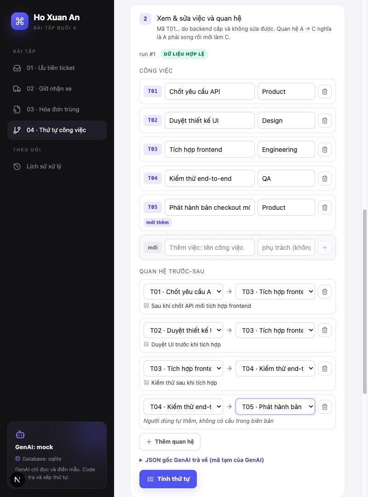
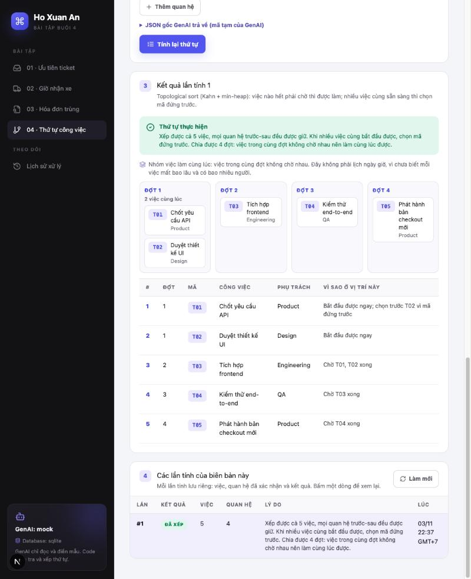
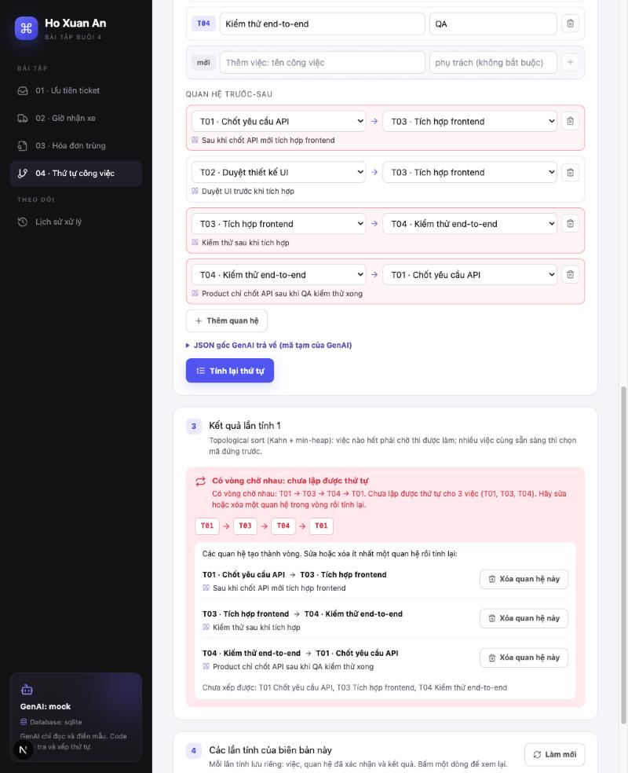
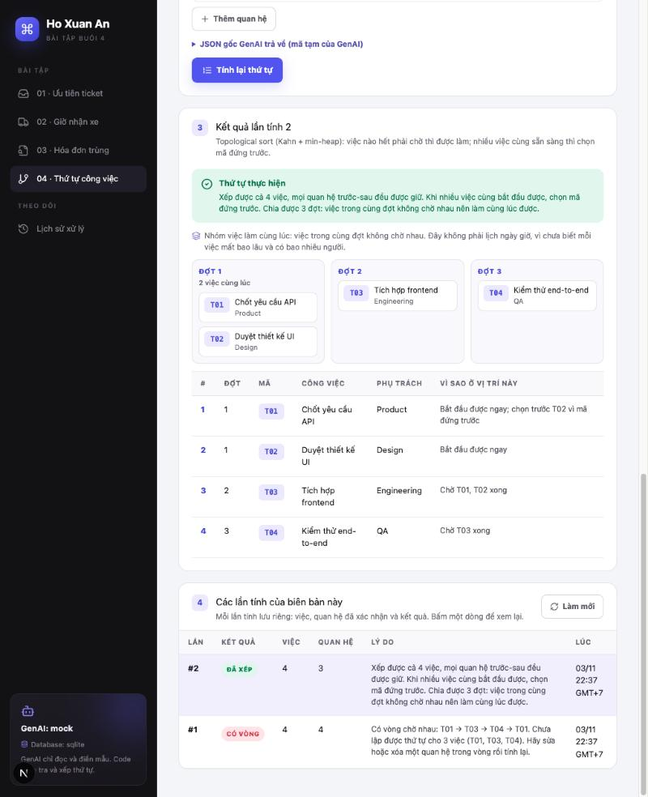
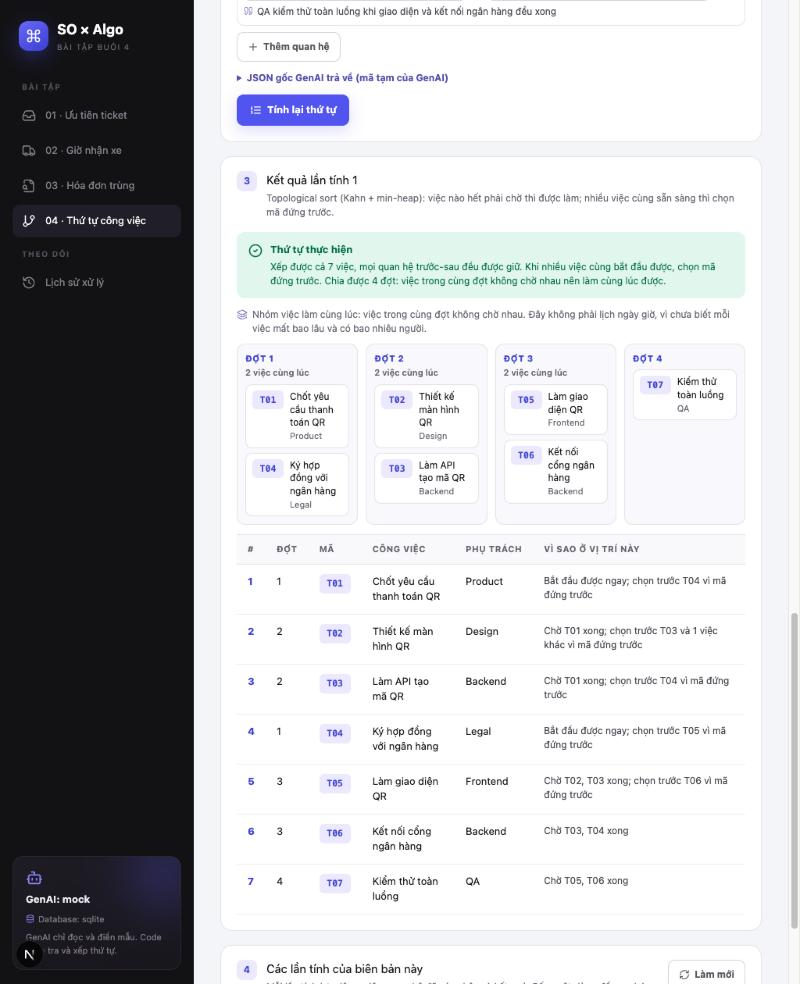
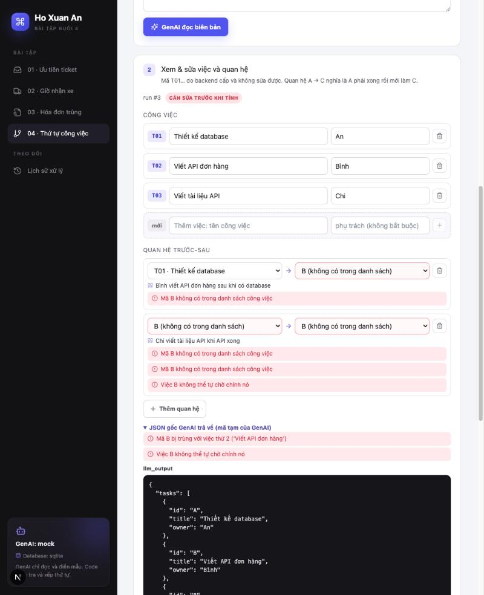

# Bài 04 · Việc nào phải làm trước?

Sau buổi họp, nhóm có nhiều việc phải làm: chốt API, duyệt giao diện, tích hợp frontend, kiểm thử. Biên bản thường viết thành đoạn văn, nên khó thấy việc nào bắt đầu được ngay và việc nào phải chờ. App đọc biên bản, lập danh sách việc và quan hệ trước-sau, rồi **xếp thứ tự làm**. Nếu các việc chờ nhau thành vòng ("A chờ B" và "B chờ A"), app **báo vòng** để nhóm sửa.

← [README chung](../../README.md) (cách cài đặt và chạy)

## 1. GenAI làm gì, code làm gì

| Bước | Ai làm | Việc cụ thể |
|---|---|---|
| Đọc biên bản | **GenAI** | Tìm các việc (`tasks`) và quan hệ trước-sau (`dependencies`). Mỗi quan hệ kèm **câu bằng chứng** chép nguyên văn từ biên bản |
| Kiểm tra kết quả GenAI | **Code** | Đúng khuôn chưa (Pydantic). Mã lạ, mã trùng, việc tự chờ chính nó, quan hệ ghi lặp, câu bằng chứng có thật trong biên bản không |
| Cấp mã việc | Hệ thống | Đổi mã tạm của GenAI (A, B, 1, 2…) sang T01, T02… theo thứ tự xuất hiện. Việc người dùng thêm cũng được backend cấp mã |
| Xem và sửa | Người dùng | Sửa tên, người phụ trách; thêm hoặc xóa việc và quan hệ. Ô mã bị khóa |
| Xếp thứ tự | **Code** | Topological sort (Kahn + min-heap). GenAI **không** xếp thứ tự và **không** tự sửa vòng |
| Nhóm việc làm cùng lúc | **Code** | Chia các việc thành đợt (phần làm thêm). Không đổi thành lịch ngày giờ |
| Sửa vòng | Người dùng | Xem các quan hệ tạo thành vòng (kèm câu bằng chứng), xóa hoặc sửa một quan hệ rồi tính lại |

```
biên bản ──► [GenAI] ──► JSON thô (mã tạm A, B…) ──► [Code: kiểm tra 2 lớp + cấp mã T01…] ──► người dùng xem/sửa
                                                                                                  │ tính thứ tự
                                                                                                  ▼
            thứ tự + lý do từng việc ◄── ordered ──┬── [Code: Kahn + min-heap] ◄── chỉ quan hệ người dùng đã xác nhận
            vòng + các quan hệ cần sửa ◄── cycle_detected ┘          │
                                                                     └──► lưu mỗi lần tính (plan_orders)
```

## 2. Mẫu dữ liệu GenAI phải trả

Mẫu định nghĩa bằng Pydantic tại [`schemas.py`](../../backend/app/modules/plans/schemas.py) (class `PlanExtraction`). JSON Schema đầy đủ: [`plan_extraction.schema.json`](plan_extraction.schema.json).

```json
{
  "tasks": [
    {"id": "A", "title": "Chốt yêu cầu API", "owner": "Product"},
    {"id": "B", "title": "Duyệt thiết kế UI", "owner": "Design"},
    {"id": "C", "title": "Tích hợp frontend", "owner": "Engineering"},
    {"id": "D", "title": "Kiểm thử end-to-end", "owner": "QA"}
  ],
  "dependencies": [
    {"before": "A", "after": "C", "evidence": "Sau khi chốt API mới tích hợp frontend"},
    {"before": "B", "after": "C", "evidence": "Duyệt UI trước khi tích hợp"},
    {"before": "C", "after": "D", "evidence": "Kiểm thử sau khi tích hợp"}
  ]
}
```

| Ô | Kiểu | Quy tắc |
|---|---|---|
| `tasks[].id` | string, 1–20 ký tự | Mã **tạm** để nối việc với quan hệ. Biên bản đã đánh mã (A, B, 1, 2…) thì dùng đúng mã đó, nếu không thì đặt A, B, C… **Không dùng tên việc làm mã** |
| `tasks[].title` | string, 1–200 ký tự | Tên việc ngắn gọn, giữ ý của biên bản |
| `tasks[].owner` | string \| null | Người hoặc nhóm phụ trách. Biên bản không nói thì `null`, không đoán theo loại việc |
| `dependencies[].before` | string | Mã việc phải xong trước |
| `dependencies[].after` | string | Mã việc chỉ làm được sau khi `before` xong |
| `dependencies[].evidence` | string, 1–300 ký tự | **Bắt buộc.** Câu chép nguyên văn từ biên bản. Không có câu nào thì không được tạo quan hệ |

- Mẫu không cho phép ô lạ (`additionalProperties: false`). GenAI gửi thêm `"order": [...]` để tự xếp thứ tự sẽ bị lớp 1 từ chối.
- Tối đa 100 việc và 500 quan hệ. Biên bản tối đa 20.000 ký tự.
- Prompt ([`extractor.py`](../../backend/app/modules/plans/extractor.py)) đặt biên bản trong thẻ `<minutes>` và nói rõ đó là dữ liệu, không phải chỉ dẫn. Prompt giải thích hướng mũi tên bằng 2 câu ví dụ của đề, và cấm GenAI tự thêm quan hệ theo kinh nghiệm.

### Mã việc do backend cấp

GenAI chỉ đặt mã tạm. Sau khi kiểm tra, backend đổi sang **T01, T02… theo thứ tự việc trong JSON** và đổi luôn các quan hệ. Ví dụ trong đề: A, B, C, D thành T01, T02, T03, T04.

- Mã chỉ có nghĩa trong một kế hoạch. Trên giao diện, ô mã bị khóa.
- Việc người dùng thêm được gửi lên với `id: null`. `POST /plans/validate` cấp mã kế tiếp: số lớn nhất đang có + 1 (đang có T01–T04 thì việc mới là T05).
- Người dùng gửi mã tự đặt (ví dụ `"A"`) thì bị báo lỗi "không phải mã hệ thống cấp".
- GenAI đặt **trùng mã tạm** (mẫu 9: hai việc cùng là B): mỗi việc vẫn được mã riêng, nhưng các quan hệ dùng B **giữ nguyên `B`** và bị báo "mã không có trong danh sách". Backend không đoán B là việc nào, người dùng tự chọn lại.

### Kiểm tra 2 lớp ([`validation.py`](../../backend/app/modules/plans/validation.py))

| Lớp | Bắt lỗi gì | Mức |
|---|---|---|
| 1. Khuôn (Pydantic) | Thiếu ô, thừa ô, sai kiểu, chuỗi rỗng hoặc quá dài, quá 100 việc / 500 quan hệ | error |
| 2. Nghiệp vụ (code) | Không có việc nào; tên việc rỗng `"   "`; người phụ trách là chuỗi rỗng (không biết thì phải để `null`); **mã việc trùng**; **quan hệ dùng mã lạ**; **việc tự chờ chính nó** (`A → A`); câu bằng chứng rỗng; mã không do hệ thống cấp | error |
| | **Quan hệ ghi lặp** (chỉ tính một lần); **câu bằng chứng không có trong biên bản** (có thể GenAI tự thêm quan hệ); kế hoạch không có quan hệ nào | warning |

- **error**: chặn bước tính thứ tự.
- **warning**: chỉ nhắc, người dùng quyết định.
- **Vòng chờ nhau không phải lỗi dữ liệu.** Dữ liệu vẫn hợp lệ, và việc phát hiện vòng thuộc về thuật toán.
- Tìm câu bằng chứng: chuẩn hóa cả hai bên (Unicode NFKC, gộp khoảng trắng, chữ thường), bỏ dấu ngoặc kép và dấu câu ở 2 đầu, rồi tìm câu đó trong biên bản.
- Quan hệ người dùng tự thêm có `evidence: null` và không bị đòi câu bằng chứng.
- Quan hệ ghi lặp được gộp, giữ dòng đầu tiên. Nếu dòng đầu không có câu bằng chứng thì lấy câu của dòng sau.

**Hai danh sách vấn đề.** `POST /plans/extract` trả:
- `llm_issues`: vấn đề của JSON gốc, theo mã tạm của GenAI (ví dụ "Mã B bị trùng với việc thứ 2").
- `issues`: kiểm tra lại bản đã cấp mã, đúng vị trí dòng mà người dùng sẽ sửa (ví dụ "Việc T01 không thể tự chờ chính nó").

Phải tách vì sau khi gộp quan hệ ghi lặp, vị trí các dòng thay đổi.

## 3. Thuật toán ([`algo.py`](../../backend/app/modules/plans/algo.py))

Mỗi việc là một đỉnh, quan hệ "A trước C" là mũi tên A → C.

**Kahn + min-heap** (`topological_order`):
1. Đếm số mũi tên đi vào mỗi việc (số việc phải chờ). Quan hệ ghi lặp chỉ tính một lần.
2. Các việc không phải chờ ai vào min-heap.
3. Lấy việc có **mã đứng trước** ra khỏi heap, thêm vào thứ tự. Giảm số chờ của các việc sau nó. Việc nào về 0 thì vào heap.
4. Lặp lại tới khi heap rỗng.

**So mã** (`id_key`): theo alphabet, nhưng phần số so theo giá trị: `T2` trước `T10`, `T99` trước `T100`. Nhờ min-heap, cùng dữ liệu luôn ra cùng thứ tự, **dù đổi thứ tự việc hoặc quan hệ trong JSON**.

**Lý do từng vị trí** (`explain_step`):
- "Chờ T01, T02 xong": việc này có mũi tên đi vào từ T01, T02.
- "Bắt đầu được ngay; chọn trước T02 vì mã đứng trước": lúc chọn, T02 cũng đã sẵn sàng.

**Khi có vòng:** không xếp hết được nghĩa là có vòng. Kết quả `cycle_detected` gồm:
- `cycle`: **một vòng cụ thể**, ví dụ `T01 → T03 → T04 → T01`, bắt đầu ở mã nhỏ nhất trong vòng.
- `cycle_edges`: các mũi tên tạo thành vòng. API trả kèm câu bằng chứng của từng mũi tên để người dùng biết sửa câu nào.
- `blocked`: mọi việc chưa xếp được, gồm việc trong vòng và việc phải chờ vòng.
- **Không trả nửa danh sách thứ tự.** `order` và `steps` để rỗng.

Tìm vòng (`find_cycle`): mỗi việc bị kẹt còn ít nhất một việc trước nó cũng bị kẹt (nếu không thì nó đã được xếp). Đi ngược theo việc trước bị kẹt, sau tối đa V bước sẽ gặp lại một việc đã đi qua, và đó là vòng. Cách này dùng vòng lặp, không đệ quy, nên chuỗi 50.000 việc cũng không bị lỗi tràn đệ quy.

### Nhóm việc làm cùng lúc (làm thêm)

Mỗi việc thuộc một **đợt**: đợt 1 nếu không phải chờ ai, ngược lại là 1 + đợt muộn nhất trong các việc nó chờ. Việc trong cùng đợt không chờ nhau, nên làm cùng lúc được.

- Đợt được tính ngay trong vòng lặp Kahn. Khi một việc ra khỏi heap, mọi việc nó chờ đã được xếp và đã có đợt. Tổng cộng thêm O(V + E).
- Mỗi việc nằm ở **đợt sớm nhất có thể**: việc ở đợt k > 1 luôn chờ ít nhất một việc ở đợt k − 1.
- Trong mỗi đợt, việc xếp theo mã. Phải sắp lại, vì việc cùng đợt có thể ra khỏi heap không theo mã: D chờ A, C chờ Z, thì D ra trước C dù cùng đợt 2.
- **Thứ tự và đợt trả lời 2 câu hỏi khác nhau.** Thứ tự là một cách làm lần lượt từng việc. Đợt cho biết việc nào làm song song được. Ở mẫu 6, T04 thuộc đợt 1 nhưng đứng thứ 4 trong thứ tự, vì T02, T03 có mã nhỏ hơn và đã sẵn sàng.
- **Không phải lịch.** Đề nói chưa có thời lượng và số người thì đừng biến thứ tự thành lịch ngày giờ. App chỉ nói "đợt 2 làm sau khi đợt 1 xong phần nó cần", không nói đợt 2 bắt đầu lúc nào. Một việc ngắn ở đợt 2 có thể bắt đầu ngay khi các việc nó chờ xong, không cần đợi cả đợt 1.
- Có vòng thì không chia đợt (`stages` rỗng), giống như không trả thứ tự.

Chính thuật toán cũng chặn mã trùng, mã lạ và việc tự chờ chính nó (`build_graph`). Vì vậy, nếu có ai gọi thẳng thuật toán mà bỏ qua bước kiểm tra, dữ liệu sai cũng không ra thứ tự sai.

| Thao tác | Độ phức tạp |
|---|---|
| Xếp thứ tự V việc, E quan hệ | O((V + E) log V): mỗi việc vào và ra heap một lần |
| Tìm vòng | O(V + E) |
| Chia đợt | O(V + E), làm cùng lúc với việc xếp thứ tự |
| 10.000 việc, khoảng 25.000 quan hệ | khoảng 40 ms (test đặt giới hạn 1 giây) |

Test đối chiếu kết quả với cách thử mọi hoán vị (brute force) trên 200 đồ thị ngẫu nhiên. Hoán vị hợp lệ đầu tiên theo alphabet phải đúng bằng thứ tự Kahn + heap ra. Khi không có hoán vị nào hợp lệ, vòng trả về phải là vòng có thật.

### Ví dụ trong đề

| Dữ liệu | Kết quả |
|---|---|
| A → C, B → C, C → D | `ordered`: A, B, C, D (T01 → T02 → T03 → T04). A và B cùng bắt đầu được, chọn A vì mã đứng trước. Chia 3 đợt: {A, B}, {C}, {D} |
| Thêm D → A | `cycle_detected`: vòng A → C → D → A (T01 → T03 → T04 → T01). B không trong vòng nhưng vẫn không có thứ tự nửa vời |
| Xóa D → A | `ordered` lại như ban đầu |

## 4. API

Đề yêu cầu tối thiểu `POST /plans/extract`, `/plans/validate`, `/plans/order`. App giữ đúng 3 đường dẫn này và thêm vài API phụ.

| Endpoint | Việc làm | Lỗi |
|---|---|---|
| `POST /plans/extract` | Nhận `text`. GenAI đọc, code kiểm tra, cấp mã T01…, lưu lịch sử. Trả `llm_output`, `llm_issues`, `plan`, `issues`, `can_order`, `run_id`. **Chưa** tính thứ tự | 422 biên bản rỗng hoặc quá dài |
| `POST /plans/validate` | Nhận `run_id` và bản đang sửa. Kiểm tra lại, cấp mã cho việc mới (`id: null`). **Không lưu gì** | 404 không thấy lần extract; 422 sai khuôn |
| `POST /plans/order` | Nhận `run_id` và bản đã xác nhận. Kiểm tra lại, xếp thứ tự, chia đợt (`stages`, mỗi bước có `stage`), **lưu lần tính này**. Có vòng vẫn trả 200 với `status: "cycle_detected"` | 400 còn lỗi (mã lạ, mã trùng, tự chờ chính nó, mã không do hệ thống cấp), không lưu gì; 404; 422 |
| `GET /plans/samples` | Biên bản mẫu cho chế độ mock | |
| `GET /plans/orders?run_id=&limit=` | Các lần tính, mới nhất trước | |
| `GET /plans/orders/{order_id}` | Một lần tính, đọc từ database đúng như lúc tính | 404 |
| `GET /runs?module=plans` | Lịch sử xử lý | |

- Câu bằng chứng được so với **biên bản gốc đã lưu** ở lần extract (lấy qua `run_id`), không tin biên bản trình duyệt gửi lại.
- Chỉ quan hệ người dùng gửi lên ở bước `order` mới được dùng để tính. Quan hệ người dùng xóa trên giao diện thì không tính.

Ví dụ gọi bằng `curl` (chế độ mock, biên bản mẫu 1):

```bash
curl -s -X POST localhost:8000/plans/extract -H 'content-type: application/json' \
  -d '{"text":"Biên bản họp dự án Checkout - 21/10/2026\n- Product chốt yêu cầu API.\n- Design duyệt thiết kế UI.\n- Engineering tích hợp frontend. Sau khi chốt API mới tích hợp frontend. Duyệt UI trước khi tích hợp.\n- QA kiểm thử end-to-end. Kiểm thử sau khi tích hợp."}'
```

```bash
curl -s -X POST localhost:8000/plans/order -H 'content-type: application/json' \
  -d '{"run_id":1,"plan":{"tasks":[{"id":"T01","title":"Chốt yêu cầu API"},{"id":"T02","title":"Duyệt thiết kế UI"},{"id":"T03","title":"Tích hợp frontend"},{"id":"T04","title":"Kiểm thử end-to-end"}],"dependencies":[{"before":"T01","after":"T03"},{"before":"T02","after":"T03"},{"before":"T03","after":"T04"},{"before":"T04","after":"T01"}]}}'
```

Lệnh thứ hai thêm T04 → T01 nên trả `cycle_detected`. Thay `run_id` bằng số lệnh đầu trả về.

## 5. Dữ liệu và lưu lại để xem sau

| Bảng | Nội dung |
|---|---|
| `runs` | Biên bản gốc (`raw_input`), JSON GenAI trả (`llm_output`), bản người dùng sửa ở lần tính mới nhất (`user_output`), kết quả mới nhất (`result`: mã lần tính, thứ tự hoặc vòng, `edited_fields`), thời gian GenAI xử lý |
| `plan_orders` | **Mỗi lần bấm "Tính thứ tự" một dòng mới**, không ghi đè: lần tính thứ mấy (`version`), danh sách việc, quan hệ đã xác nhận (đã gộp dòng ghi lặp), `status`, kết quả (thứ tự kèm lý do, hoặc vòng kèm câu bằng chứng và các việc bị kẹt), cảnh báo |

- Gặp vòng, sửa rồi tính lại: lịch sử có cả lần `cycle_detected` lẫn lần `ordered`, để xem lại vì sao lần đầu không xếp được.
- `edited_fields` so với bản GenAI **đã đổi sang mã T01…**. Nếu so thẳng với JSON gốc thì mọi ô đều bị tính là đã sửa, vì GenAI dùng mã tạm A, B.
- Bài này không giữ gì trong bộ nhớ, nên không cần khóa và không cần dựng lại khi khởi động. Mỗi lần tính chỉ ghi vào database.
- Bảng trên Supabase: [`schema.sql`](../../backend/supabase/schema.sql), có ràng buộc `status in ('ordered','cycle_detected')`.

## 6. Giao diện

1. **Dán biên bản**, hoặc chọn một trong 10 biên bản mẫu.
2. **Xem và sửa:**
   - Mã T01… hiện thành nhãn khóa. Việc mới thêm hiện "…" rồi nhận mã từ backend.
   - Mỗi quan hệ có 2 ô chọn trước → sau, và **câu bằng chứng hiện ngay bên dưới**. Quan hệ người dùng tự thêm ghi "không có câu trong biên bản".
   - Xóa một việc thì xóa luôn các quan hệ dùng mã đó.
   - Mã lạ do GenAI trả vẫn hiện trong ô chọn, ví dụ "B (không có trong danh sách)", để người dùng thấy và chọn lại.
   - Mỗi lần sửa, bản nháp được gửi `/plans/validate` sau khi ngừng gõ khoảng 0,35 giây. Lỗi bám theo dòng, nên không nhảy sai chỗ khi thêm hoặc xóa dòng khác. Còn lỗi thì nút "Tính thứ tự" bị khóa.
3. **Kết quả:**
   - **Xếp được:** các đợt làm cùng lúc (mỗi đợt một cột), rồi bảng thứ tự kèm đợt và lý do từng việc.
   - **Có vòng:** đường đi của vòng, từng quan hệ kèm câu bằng chứng và nút "Xóa quan hệ này". Các quan hệ đó cũng được tô đỏ ở bước 2.
   - **Sửa sau khi tính:** trang báo bản đang sửa khác bản đã tính, kèm nút nạp lại bản của lần tính đó.
4. **Các lần tính của biên bản:** bấm một dòng để xem lại đúng như lúc tính.

## 7. Test

Chạy `cd backend && myenv/bin/python -m pytest -q`. Thuật toán được test riêng, không phụ thuộc GenAI.

| File | Số test | Nội dung |
|---|---|---|
| [`test_plans_algo.py`](../../backend/tests/test_plans_algo.py) | 328 | Thuật toán thuần, chia 3 nhóm theo đề: ca thường, ca sát giới hạn, dữ liệu sai. So với brute force trên 200 đồ thị ngẫu nhiên, 10.000 việc dưới 1 giây, vòng 50.000 việc. Chia đợt: kiểm tra trên 100 đồ thị ngẫu nhiên rằng mũi tên luôn sang đợt sau và mỗi việc ở đợt sớm nhất |
| [`test_plans_validation.py`](../../backend/tests/test_plans_validation.py) | 57 | Mẫu JSON, kiểm tra 2 lớp, cấp mã, câu bằng chứng, từng biên bản mẫu |
| [`test_plans_extractor.py`](../../backend/tests/test_plans_extractor.py) | 29 | GenAI (mock và giả lập lỗi model), prompt, schema đổi sang tool OpenAI |
| [`test_plans_store.py`](../../backend/tests/test_plans_store.py) | 5 | Database: mỗi lần tính một dòng, đánh số lần tính, cập nhật run |
| [`test_plans_api.py`](../../backend/tests/test_plans_api.py) | 22 | Toàn bộ API bằng `TestClient`, lưu lại sau khi khởi động lại app, đọc được lần tính lưu trước khi có chia đợt |

### Đối chiếu phần "Tự kiểm tra" của đề

| Đề yêu cầu | Test |
|---|---|
| Ví dụ trong đề ra A → B → C → D | `test_exercise_example`, `test_order_exercise_example` |
| Đổi thứ tự task trong JSON vẫn cùng kết quả | `test_same_result_when_tasks_and_edges_are_shuffled`, `test_same_plan_with_shuffled_json_gives_same_order` |
| Thêm D → A thì báo vòng, xóa thì lập được thứ tự | `test_adding_d_to_a_reports_cycle_then_removing_it_orders_again`, `test_fix_cycle_and_order_again_keeps_both_versions` |
| Có vòng thì không hiện nửa danh sách | `test_adding_d_to_a_reports_cycle_then_removing_it_orders_again`, `test_tasks_waiting_on_a_cycle_are_blocked_too`, `test_cycle_is_reported_with_evidence_and_saved` |
| Mã lạ | `test_unknown_task_is_rejected`, `test_unknown_id_is_error`, `test_order_rejects_unknown_task` |
| Task tự chờ chính nó | `test_self_dependency_is_rejected`, `test_self_dependency_is_error`, `test_order_rejects_self_dependency_from_genai` |
| ID trùng | `test_duplicate_task_id_is_rejected`, `test_duplicate_task_id_is_error_and_its_dependencies_are_not_guessed`, `test_duplicate_id_errors_point_to_rows_of_the_plan` |
| Quan hệ trùng chỉ tính một lần | `test_duplicate_edge_counted_once`, `test_duplicate_dependency_counted_once`, `test_repeated_dependency_is_reported_once_and_merged` |
| Kế hoạch không có quan hệ nào | `test_no_dependencies_orders_by_id`, `test_no_dependencies_is_warning`, `test_no_dependencies_is_ordered_with_warning` |
| GenAI không tự thêm quan hệ khi không có bằng chứng | `test_evidence_not_in_minutes_is_warning_only`, `test_invented_dependency_is_warned`, `test_system_prompt_states_rules` |
| Chỉ dùng quan hệ người dùng đã xác nhận | `test_added_task_and_dependency_without_evidence`, `test_model_failure_run_can_still_be_filled_by_hand` |
| O((V + E) log V) | `test_10000_tasks_run_fast`, `test_matches_brute_force_on_random_graphs` |
| Làm thêm: nhóm việc làm cùng lúc | `test_exercise_stages`, `test_qr_launch_plan_stages`, `test_stage_is_sorted_by_id_even_if_ready_later`, `test_stages_are_valid_on_random_graphs`, `test_cycle_has_no_stages` |

## 8. Dữ liệu mẫu (chế độ mock)

[`samples/plans.json`](../../backend/samples/plans.json) có 10 biên bản. Mỗi mẫu ghi kết quả mong đợi (`expect_can_order`) và được test kiểm tra.

| Mẫu | Mục đích |
|---|---|
| 1 | Đúng ví dụ trong đề: A → B → C → D |
| 2 | Mẫu 1 thêm câu "Product chỉ chốt API sau khi QA kiểm thử xong": vòng A → C → D → A |
| 3 | Ba việc độc lập: không có quan hệ, xếp theo mã, có cảnh báo |
| 4 | Biên bản nhắc lại một quan hệ, GenAI ghi 2 dòng: chỉ tính một lần |
| 5 | Biên bản đánh số sẵn 1, 2, 3, một việc không ghi ai làm: đổi sang T01–T03, `owner` null |
| 6 | Ra mắt thanh toán QR, 7 việc, nhiều nhánh: có việc chờ 2 việc khác |
| 7 | [Lỗi] GenAI ghi quan hệ tới việc không có trong danh sách |
| 8 | [Lỗi] GenAI gộp 2 việc làm một rồi ghi A → A |
| 9 | [Lỗi] GenAI đặt mã B cho 2 việc khác nhau |
| 10 | Biên bản nói 2 việc làm song song, GenAI vẫn thêm quan hệ với câu không có trong biên bản: cảnh báo |

Chế độ mock chọn mẫu **dài nhất** có nội dung nằm trong prompt. Biên bản mẫu 2 chứa trọn mẫu 1, nên nếu lấy mẫu khớp đầu tiên thì sẽ nhận nhầm kết quả của mẫu 1.

## 9. Ảnh chụp luồng chính

**Xem và sửa (mẫu 1):** mã T01–T04 bị khóa. Câu bằng chứng nằm dưới mỗi quan hệ. Người dùng thêm việc "Phát hành bản checkout mới" (backend cấp T05) và quan hệ T04 → T05 không có câu trong biên bản.



**Thứ tự kèm lý do:** T01 và T02 cùng bắt đầu được, chọn T01 vì mã đứng trước. T03 chờ T01, T02. Lần tính được lưu ở bảng bên dưới, giờ hiển thị theo GMT+7.



**Vòng chờ nhau (mẫu 2):** ba quan hệ trong vòng được tô đỏ ở bước sửa. Kết quả hiện vòng T01 → T03 → T04 → T01, câu bằng chứng của từng quan hệ, và các việc chưa xếp được. Không có thứ tự nửa vời.



**Xóa T04 → T01 rồi tính lại:** lần tính 2 xếp được T01 → T02 → T03 → T04. Lịch sử giữ cả lần 1 (có vòng) và lần 2.



**Nhóm việc làm cùng lúc (mẫu 6, ra mắt thanh toán QR):** 4 đợt. T01 chốt yêu cầu và T04 ký hợp đồng ngân hàng làm cùng lúc ở đợt 1. T06 kết nối cổng ngân hàng chờ T04 (đợt 1) và T03 (đợt 2), nên ở đợt 3. Ghi chú nói rõ đây không phải lịch ngày giờ.



**Hai việc cùng mã (mẫu 9):** mỗi việc vẫn được mã riêng. Các quan hệ dùng `B` hiện "B (không có trong danh sách)" và báo lỗi đúng dòng. JSON gốc tự mở để thấy lý do: "Mã B bị trùng".



## 10. Giới hạn và các quyết định

- **Thứ tự và đợt không phải lịch.** App chỉ nói việc nào trước việc nào và việc nào làm cùng lúc được. Không có thời lượng hay số người nên không tự đổi thành ngày giờ, và không nói một đợt cần bao nhiêu người.
- **Lần tính lưu trước khi có chia đợt** vẫn đọc lại được, chỉ là không có đợt (`stages` rỗng, `stage` là `null`).
- **Chỉ báo một vòng.** Đồ thị có nhiều vòng thì sửa vòng này, tính lại sẽ thấy vòng tiếp theo. Danh sách `blocked` cho biết mọi việc đang bị kẹt.
- **Câu bằng chứng chỉ được so khớp chuỗi**, sau khi chuẩn hóa. GenAI viết lại câu bằng lời khác thì bị cảnh báo dù quan hệ đúng. Ngược lại, câu có thật trong biên bản không chứng minh GenAI hiểu đúng hướng mũi tên. Người dùng vẫn cần đọc lại.
- **Mã việc chỉ có nghĩa trong một kế hoạch.** Xóa T04 rồi thêm việc mới thì việc mới có thể nhận lại T04. Các lần tính cũ vẫn đúng vì mỗi lần lưu cả tên việc.
- **Chế độ mock chỉ đọc được biên bản có trong `samples/`.** Văn bản khác sẽ báo lỗi, nhưng người dùng vẫn tự nhập việc và quan hệ để tính được.
